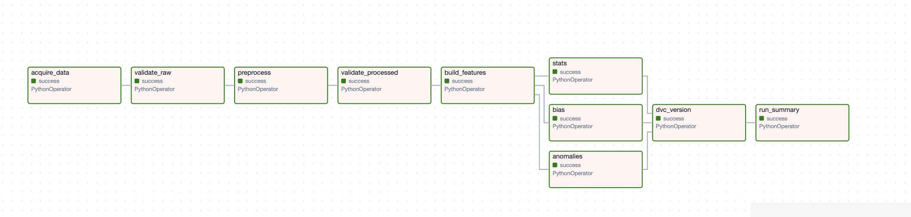
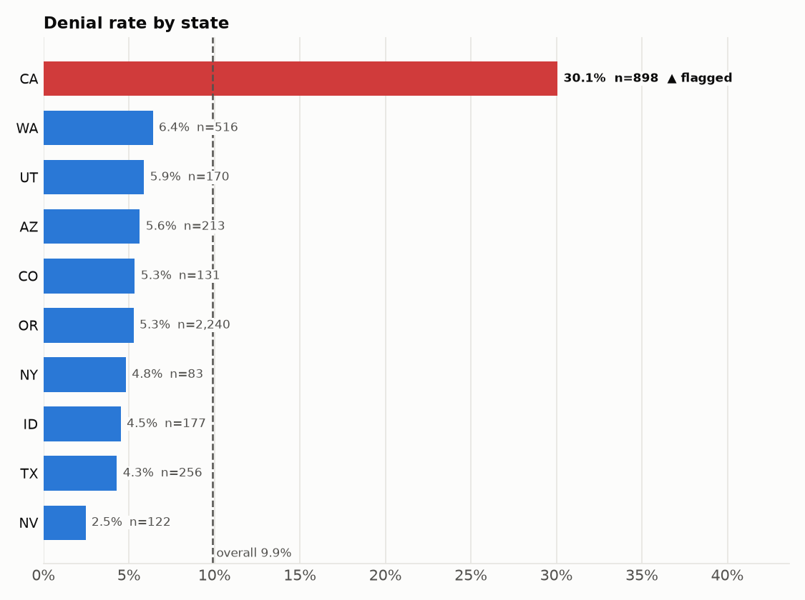
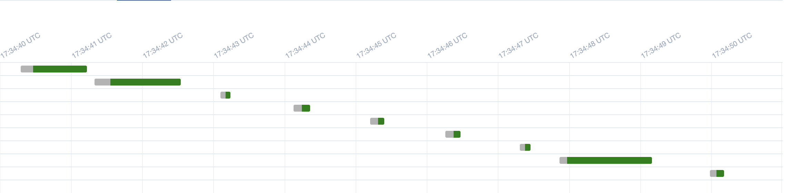
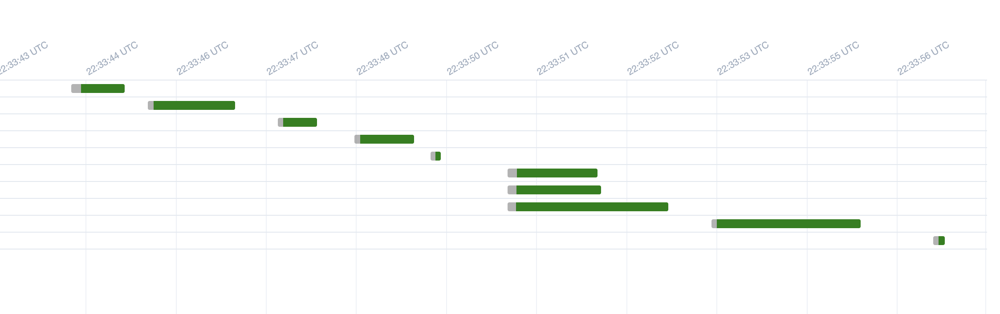

# nsh-data-pipeline

[](https://github.com/jaira26/nsh-data-pipeline/actions/workflows/ci.yml)

**MLOps Milestone 1: Data Pipeline.** An Airflow-orchestrated, DVC-versioned, fully tested pipeline that
generates a realistic **synthetic** dataset for Nonstop Health (NSH), downloads and checksum-verifies it, validates
it, cleans it into reporting tables, checks it for anomalies and bias, and versions every output.


---

## Contents

1. [Problem & overview](#1-problem--overview)
2. [Dataset](#2-dataset)
3. [Architecture](#3-architecture)
4. [Repository structure](#4-repository-structure)
5. [Prerequisites](#5-prerequisites)
6. [Reproduce step by step](#6-reproduce-step-by-step)
7. [Pipeline stages](#7-pipeline-stages)
8. [Data versioning (DVC)](#8-data-versioning-dvc)
9. [Schema, statistics, anomaly detection & alerts](#9-schema-statistics-anomaly-detection--alerts)
10. [Bias detection (data slicing)](#10-bias-detection-data-slicing)
11. [Pipeline flow optimization](#11-pipeline-flow-optimization)
12. [Tracking & logging](#12-tracking--logging)
13. [Testing & CI](#13-testing--ci)
14. [Design decisions](#14-design-decisions)
15. [Known limitations](#15-known-limitations)
16. [Troubleshooting](#16-troubleshooting)
17. [Team contributions](#17-team-contributions)

---

## 1. Problem & overview

NSH is a third-party administrator for self-funded employer health plans. Its reporting runs on dashboards over
MongoDB, and the proposed replacement (an LLM-driven "Agentic Reporting Platform") must be built and tested
**without access to real member data**. The vendor scoping plan lists a referentially consistent synthetic dataset
as a P0 blocker that does not yet exist.

This pipeline delivers that dataset plus everything needed to trust it:

| Requirement | How this repo covers it |
|---|---|
| Data acquisition | Seeded generator publishes a versioned dataset as a GitHub Release asset; `download.py` fetches it, verifies SHA-256, and falls back to local generation offline |
| Data preprocessing | Current-version extraction, money/date normalization, test-org exclusions, PHI minimization, 9 flat Parquet tables |
| Test modules | `pytest` unit, schema, contract and DAG tests for every module; GitHub Actions CI with an 80% coverage gate |
| Airflow DAG | `nsh_data_pipeline` DAG in Docker Compose (Airflow 2.10.5, LocalExecutor, Postgres) |
| Data versioning | `dvc.yaml` stages mirror the DAG; `dvc.lock` committed; `dvc_version` task in the DAG |
| Tracking & logging | Per-module loggers streamed into Airflow task logs; `reports/run_summary.json` per run |
| Schema & statistics | pandera schemas (raw light / processed strict), per-table stats JSON, drift vs a committed baseline |
| Anomaly detection & alerts | 11 rule-based checks for the data contract's known hazards; Slack / email alert on failure |
| Bias detection | Data slicing with Fairlearn `MetricFrame`, significance-tested flags, reweighing mitigation |
| Pipeline flow optimization | Stats, anomalies and bias run in parallel; toggle with `NSH_PARALLEL_REPORTS` for a before/after Gantt |
| Code structure | scikit-learn-style `src/` package, `tests/` mirrors `src/`, `pyproject.toml`, ruff |

**Scope.** This milestone is only the data pipeline: no LLM, agent or dashboard UI.

---

## 2. Dataset

### Data card

| | |
|---|---|
| Source | Generated by `src/nsh_pipeline/generate/` following the NSH data contract (`01-data-contract-package.md`) |
| Published copy | GitHub Release [`data-v1.0`](https://github.com/jaira26/nsh-data-pipeline/releases/tag/data-v1.0), `nsh-raw-small-v1.0.tar.gz` |
| Checksum | SHA-256 `e6871efbf48dd262990f4dbd417ee992a033d0aef0afab62fdea0fb8670fc69f` (in `params.yaml → dataset`) |
| Seed / as-of date | `seed: 42`, `reference_date: 2025-06-15` (no "today" anywhere, so runs are reproducible) |
| Scales | `small` (default; 60 clients, CI and grading) and `full` (605 clients, the real book size) |
| Format | JSON Lines, one file per MongoDB collection, field names exactly as the contract (misspellings included) |
| PHI | All fake (Faker), but SSN, DOB, names and addresses are still treated as sensitive: masked or dropped in preprocessing, and `assert_no_phi` blocks any leak |
| Determinism | Same seed → byte-identical files (tested) |

### Collections (`data/raw/`, `small` scale)

| File | One record is | Rows |
|---|---|---|
| `applications.jsonl` | a client employer (+ the 2 non-client orgs NS Demo and NSAI) | 62 |
| `people.jsonl` | a member, with `Names[]` / `Employment[]` / `Benefits[]` history arrays | 1,377 |
| `debit_card_status.jsonl` | a WEX card record (several per member) | 1,714 |
| `wex_claims.jsonl` | a debit-card swipe | 4,845 |
| `tickets.jsonl` | a support / substantiation ticket | 183 |
| `claims.jsonl` | a manual reimbursement claim | 83 |
| `bills.jsonl` | a client's monthly invoice | 372 |
| `reserves.jsonl` | a client's monthly claims-fund balance | 372 |
| `nse_transaction_daily_logs.jsonl` | a ledger transaction (integer cents) | 4,435 |
| `manifest.json` | seed, scale, row count and SHA-256 per file, injected-issue answer key | 1 |

**Contract quirks reproduced on purpose:** money in three units (cents, numeric strings like `"1,250.75"`, plain
dollars); `M/D/YYYY`, `YYYY-MM` and ISO dates; history arrays with `Deleted` / `Active` flags; string `_id` on swipes;
misspelled fields `needsSubstantion` and `pariticpant_status`; mixed status casing; the two non-client orgs.

Full details: [docs/data_acquisition.md](docs/data_acquisition.md).

---

## 3. Architecture

```
 params.yaml ──► acquire_data ─► validate_raw ─► preprocess ─► validate_processed ─► build_features ─┬─► stats ─────┬─► dvc_version ─► run_summary
 (seed, scale,   download +       manifest +      9 Parquet      strict pandera                       ├─► anomalies ─┤    dvc commit      reports/
  thresholds)    SHA-256 check    raw schemas     tables         schemas                              └─► bias ──────┘    (+ dvc push)    run_summary.json
                 (fallback:                                                                             parallel
                  generate)
```



| Task | What it does | Calls |
|---|---|---|
| `acquire_data` | Download the release archive, verify SHA-256, extract safely, verify every file against the manifest; generate from the seed if offline | `acquire.download.acquire_data` |
| `validate_raw` | Every raw file exists and matches the manifest; light raw schemas | `validation.run --step raw` |
| `preprocess` | Clean and flatten into 9 Parquet tables; row counts to XCom | `preprocess.run.run_preprocess` |
| `validate_processed` | Strict pandera schemas on the 9 tables (fail → stop + alert) | `validation.run --step schema` |
| `build_features` | Reporting tables into `data/features/` (see [limitations](#15-known-limitations)) | `features.run` |
| `stats` | Per-table statistics JSON and drift vs baseline | `validation.run --step stats` |
| `anomalies` | 11 hazard checks; critical findings fail the task and alert | `validation.run --step anomalies` |
| `bias` | Slice outcomes by client / member group, flag disparities, reweigh | `bias.slicing` |
| `dvc_version` | `dvc commit -f` every stage so `dvc.lock` matches the run; optional `dvc push` | `orchestration.versioning.dvc_version` |
| `run_summary` | Write `reports/run_summary.json` | `orchestration.summary` |

**One codebase, three runners.** Every stage is a plain Python function with a `python -m` CLI.
Airflow tasks and `dvc.yaml` stages call the same functions, and `pytest` tests them directly. The DAG file contains
**no business logic**: it only wires tasks together. CLI commands for the DAG are registered in one place,
`src/nsh_pipeline/orchestration/stages.py`.

### Data layers

| Folder | Contents | Format | Tracked by |
|---|---|---|---|
| `data/raw/` | Collection-shaped synthetic documents, quirks included | `.jsonl` | DVC |
| `data/processed/` | Clean, typed tables (one row per entity) | Parquet | DVC |
| `data/features/` | Reporting / aggregate tables | Parquet | DVC |
| `data/bias/` | `swipe_weights.parquet` (reweighing output) | Parquet | DVC |
| `reports/` | Stats, drift, anomaly, bias and run-summary reports | JSON / Markdown / PNG | DVC (`cache: false`) |
| `reports/baseline/` | Stats of the clean seed-42 run, the drift reference | JSON | git |

---

## 4. Repository structure

```
nsh-data-pipeline/
├── README.md                     # this file
├── pyproject.toml                # package metadata, ruff + pytest config
├── requirements.txt              # pinned versions CI installs
├── params.yaml                   # seed, scale, injection flags, dataset URL, validation + bias thresholds
├── params.injected.yaml          # params.yaml with injection on and validation in report mode
├── docker-compose.yaml           # Airflow webserver, scheduler, init, Postgres
├── Dockerfile                    # apache/airflow:2.10.5-python3.11 + this package + DVC
├── .env.example                  # Airflow user, parallel/DVC toggles, Slack/SMTP placeholders
├── dvc.yaml  dvc.lock  .dvc/     # DVC pipeline, output hashes, remote config
├── dags/
│   └── nsh_data_pipeline.py      # DAG wiring only
├── src/nsh_pipeline/
│   ├── config.py                 # loads params.yaml
│   ├── constants.py              # excluded org ids, contract enums
│   ├── generate/                 # clients, people, activity (swipes/tickets/claims), cards, finance, inject, run
│   ├── acquire/                  # download (fetch + verify + fallback), publish (tarball + manifest)
│   ├── preprocess/               # money, dates, people_current, exclusions, privacy, flatten, run
│   ├── validation/               # schemas/, stats, drift, anomalies, answer_key, enums, run
│   ├── bias/                     # slicing, metrics, mitigation (reweighing), report
│   ├── orchestration/            # stages registry, runner, versioning (DVC), summary + failure alert
│   └── utils/                    # io, keys (shared nswid), alerts (Slack / SMTP)
├── tests/                        # mirrors src/ one-to-one
│   ├── fixtures/                 # hand-made sample dataset with every quirk (no network needed)
│   ├── generate/ acquire/ preprocess/ validation/ bias/ orchestration/ utils/
│   └── conftest.py
├── docs/                         # per-stage docs, decisions, evidence reports, screenshots
├── reports/baseline/             # committed drift baseline
└── .github/workflows/ci.yml      # ruff + pytest with coverage gate
```

---

## 5. Prerequisites

| Route | Needs |
|---|---|
| Docker (full Airflow demo) | Docker Desktop with **≥ 4 GB RAM** allocated (Windows: WSL2 backend), Git |
| No Docker (DVC / CLI) | Python **3.11+**, Git |

Clone outside OneDrive / iCloud-synced folders; file syncing breaks Docker volume mounts and DVC's cache.

---

## 6. Reproduce step by step

### Option A: Airflow in Docker (the graded demo)

```bash
git clone https://github.com/jaira26/nsh-data-pipeline.git
cd nsh-data-pipeline
cp .env.example .env              # Linux: set AIRFLOW_UID to the output of `id -u`
mkdir -p logs/airflow             # PowerShell: mkdir logs\airflow
docker compose build              # first time ~5 min
docker compose up airflow-init    # wait for "exited with code 0"
docker compose up -d
docker compose ps                 # webserver + scheduler "healthy" after ~1 min
```

1. Open **http://localhost:8080** and log in as `airflow` / `airflow`.
2. Switch `nsh_data_pipeline` on and press **▶ Trigger DAG**.
3. Watch the **Grid** view; click a task square → **Logs** to see its output.
4. Outputs appear on your machine (the repo is mounted into the containers):
   `data/raw/`, `data/processed/`, `data/features/`, `reports/` and `reports/run_summary.json`.

Stop with `docker compose down` (add `-v` to wipe the Airflow database).

### Option B: No Docker (DVC)

```bash
git clone https://github.com/jaira26/nsh-data-pipeline.git
cd nsh-data-pipeline
python -m venv .venv
source .venv/bin/activate         # Windows: .venv\Scripts\Activate.ps1
pip install -r requirements.txt   # exact versions CI tests with
pip install -e ".[dev]"
dvc repro                         # runs every stage in dvc.yaml whose inputs changed
pytest --cov=nsh_pipeline         # run the test suite
```

No credentials are needed for either route: the dataset is a public release asset, and if the download fails the
same data is regenerated from the seed.

---

## 7. Pipeline stages

Every stage can be run alone from the repo root.

### 7.1 Data generation & acquisition (M1)

```bash
python -m nsh_pipeline.acquire.download --params params.yaml --out-dir data/raw   # download (or generate)
python -m nsh_pipeline.generate.run     --params params.yaml --out-dir data/raw   # generate directly
```

- **Generator**: builds collections in dependency order
  (`clients → members → swipes → tickets, claims, cards → bills → reserves → ledger`), so every foreign key resolves.
  Lognormal group sizes, 85% Active clients, 0.1% VIP, 5% POS declines, ~2.5% of card swipes needing substantiation
  (NSH's real rate is ~2.2%). Reserves roll forward (previous + billed − paid) and ledger cents equal swipe payments
  (tested).
- **Download**: retries with growing backoff and a timeout, verifies SHA-256 **before** unpacking, extracts safely
  (`filter="data"`, no path escapes), checks every file against `manifest.json`, and falls back to local generation
  on any failure.
- **Publish** a new version: `python -m nsh_pipeline.acquire.publish --raw-dir <dir> --out <archive>.tar.gz`, attach it
  to a `data-vX.Y` GitHub Release, and put its URL and SHA-256 in `params.yaml → dataset`.
- **Injected issues** (`inject_issues.enabled: true`): duplicate bill lines, cents-as-dollars amounts, orphan swipes,
  unparseable money, future service dates, status casing drift, and a denial skew in one state. They use a separate
  RNG (seed + 1), so only the injected records change, and every one is listed in `manifest.json → injected_issues`
  as an answer key.

Details: [docs/data_acquisition.md](docs/data_acquisition.md).

### 7.2 Preprocessing (M2)

```bash
python -m nsh_pipeline.preprocess.run --raw-dir data/raw --out-dir data/processed --as-of 2025-06-15
```

| Problem in the raw data | Handled by |
|---|---|
| Money in cents / numeric strings / dollars (a silent 100× error if guessed) | `money.py`: unit declared per field, NaN-safe parsing |
| Member data as history arrays | `people_current.py`: current = last entry not `Deleted` / not inactive, never index `[0]` |
| Dates as ISO, `M/D/YYYY`, `YYYY-MM` | `dates.py`: format declared per field, all UTC |
| NS Demo / NSAI are not clients | `exclusions.py`: flagged in `clients`, dropped elsewhere (by id **or** alias) |
| SSN, DOB, addresses | `privacy.py`: masked SSN, age band, raw PHI dropped, `assert_no_phi` before writing |
| Member join key `nswid` | `utils/keys.py`: one `make_nswid` shared by generator and preprocessing |

**Output: 9 Parquet tables** in `data/processed/`: `clients`, `members`, `member_benefits`, `swipes`, `claims`,
`tickets`, `bill_lines`, `reserves`, `ledger`. Conventions: snake_case columns, money in `*_usd` float dollars, UTC
timestamps, string IDs, no raw SSN / full DOB / address. Derived fields: group-size bucket, 4-bucket employee status,
ticket `sla_breached` (40-hour SLA).

Details: [docs/preprocessing.md](docs/preprocessing.md).

### 7.3 Validation, statistics, anomalies & alerts (M3)

```bash
python -m nsh_pipeline.validation.run --step all      # or raw | schema | stats | anomalies
```

See [section 9](#9-schema-statistics-anomaly-detection--alerts) and [docs/validation.md](docs/validation.md).

### 7.4 Bias detection (M5)

```bash
python -m nsh_pipeline.bias.slicing --processed-dir data/processed --params params.yaml
```

See [section 10](#10-bias-detection-data-slicing) and [docs/bias.md](docs/bias.md).

### 7.5 Orchestration, versioning & run summary (M4)

The DAG, Docker setup, DVC stages and run summary. See sections [3](#3-architecture), [8](#8-data-versioning-dvc),
[11](#11-pipeline-flow-optimization), [12](#12-tracking--logging) and [docs/airflow_dvc.md](docs/airflow_dvc.md).

---

## 8. Data versioning (DVC)

- `dvc.yaml` declares each stage's command, dependencies, parameters and outputs: `acquire`, `preprocess`, `validate`,
  `bias` (and `features` once merged). `dvc.lock` records the hash of every output. Git tracks those two files; the
  data lives in the DVC cache and remote.
- After an Airflow run, the `dvc_version` task runs `dvc commit -f` for each stage so `dvc.lock` matches what Airflow
  produced. Commit `dvc.lock` afterwards.
- `dvc push` inside the container needs remote credentials, so it is off by default (`DVC_PUSH=false` in `.env`).
  Run `dvc push` on the host instead.
- **Remote:** `.dvc/config` points at the team's DagsHub storage,
  [dagshub.com/Kalpan1104/nsh-data-pipeline](https://dagshub.com/Kalpan1104/nsh-data-pipeline).
  Run `dvc pull` to download every versioned output, or `dvc repro` to rebuild everything from the seed and the
  public release (no credentials needed for either).

- **Getting an older version of the data back:**

```bash
  git checkout <commit>     # the commit whose data you want
  dvc checkout              # restores data/ to match that commit's dvc.lock
```

---

## 9. Schema, statistics, anomaly detection & alerts

### Schemas (pandera)

| Layer | Enforces |
|---|---|
| Raw (light) | Fields preprocessing reads are present; unique keys; money and dates stored as the contract says; the misspelled fields `needsSubstantion` / `pariticpant_status` present **and their correct spellings absent** (an upstream "fix" would otherwise make preprocessing silently read nothing) |
| Processed (strict) | Exactly the agreed columns in order (a leaked `ssn` column fails), dtypes, enums, nullability, value ranges, unique keys |
| Features | Plan §6.3 rules, e.g. `mlr ≥ 0`, `sub_rate_pct` in 0–100, one row per key |

### Statistics & drift

`reports/stats/<table>.json` holds, per column: kind, null count / rate, min / max / mean / std / median, date range,
and top-5 category shares. `reports/drift.json` compares them to the committed clean baseline in `reports/baseline/`.
Thresholds come from seed-to-seed noise (seeds 1–5 vs 42), not from the injected data: category share 2.0 pts,
numeric mean 20%, null rate 1.0 pt, row count 10%, and any schema change.

### Anomaly checks

| Check | Severity | Rule |
|---|---|---|
| `duplicate_bill_lines` | critical | a (`member_id`, `billing_month`) appears more than once (PMPM double-counting) |
| `money_unit_error` | critical | a money value > 100× its column median (clean data peaks at 69.5×) |
| `orphan_keys` | critical | a `member_id` / `client_id` null or not in its parent table (14 relations) |
| `excluded_org_leak` | critical | NS Demo / NSAI in any table other than `clients`, or unflagged there |
| `unparseable_money` | critical | a `*_usd` value missing after parsing (e.g. raw `'N/A'`) |
| `active_client_count` | warning | Active clients outside 70–100% of the scale's client count |
| `enum_violations` | warning | a value outside the contract's enum lists, including casing drift |
| `future_dates` | warning | service / creation date after the as-of date |
| `negative_amounts` | warning | negative money where it cannot be negative |
| `term_before_hire` | warning | termination before hire |
| `distribution_drift` | warning | any drift finding vs the baseline |

### Alerts

`utils/alerts.send_alert` posts to a **Slack** incoming webhook and/or **email** (SMTP). Credentials come only from
`.env` (`SLACK_WEBHOOK_URL`, `SMTP_*`, `ALERT_EMAIL_TO`, `ALERT_EMAIL_FROM`). With none set, the alert is logged as a
warning and the pipeline carries on, so graders are never blocked.

- `validation.mode: strict` (default): a schema failure or any critical anomaly fails the task; the DAG's
  `on_failure_callback` sends **one** alert carrying the failed checks and sample record ids.
- `validation.mode: report`: every report and alert is produced but the task never fails (used for injected runs so
  bias and versioning still run).

### Evidence: every injected issue is caught

**Clean data:** raw passed, 9/9 processed tables passed, **0 critical**, 1 warning check (`future_dates` on 5 claims,
a known generator edge case where claims serviced just before the as-of date are created after it), drift `ok`.

**Injected data** (`params.injected.yaml`), compared automatically against the generator's answer key in
`reports/injection_detection.json`:

| Injected issue | Caught by | Injected | Detected | Missed | False positives in that table |
|---|---|---|---|---|---|
| `duplicate_bill_lines` | `duplicate_bill_lines` (critical) | 5 | **5** | 0 | 0 |
| `cents_as_dollars` | `money_unit_error` (critical) | 5 | **5** | 0 | 0 |
| `orphan_swipes` | `orphan_keys` (critical) | 5 | **5** | 0 | 0 |
| `unparseable_money` | `unparseable_money` (critical) | 5 | **5** | 0 | 0 |
| `future_service_dates` | `future_dates` (warning) | 3 | **3** | 0 | 0 |
| `status_casing_drift` | `enum_violations` (warning) | 5 | **5** | 0 | 0 |
| `denial_skew` | bias slicing (section 10) | 219 | see §10 | | |

Drift also fires on the injected run: swipe **Denied share 5.38% → 9.94%** (+4.55 pts vs a 2.0 pt threshold).

Reproduce (~15 s):

```bash
python -m nsh_pipeline.generate.run --params params.injected.yaml --out-dir data/raw_injected
python -m nsh_pipeline.preprocess.run --raw-dir data/raw_injected --out-dir data/processed_injected --as-of 2025-06-15
python -m nsh_pipeline.validation.run --step all --params params.injected.yaml \
    --raw-dir data/raw_injected --processed-dir data/processed_injected --report-dir reports/injected
```

With no Slack or SMTP credentials in `.env`, the alert is logged instead of sent. This is the alert from the injected
run above (details trimmed):

```text
WARNING nsh_pipeline.utils.alerts: ALERT (no Slack/SMTP configured, logged only): NSH validation: 4 critical anomalies
Processed dir: data/processed_injected
As of: 2025-06-15
- duplicate_bill_lines: 5 (member_id, billing_month) keys billed more than once (5 extra rows)
- money_unit_error: 5 records have money above 100x the column median (cents read as dollars?)
- orphan_keys: 5 records have a null or unresolved member_id / client_id
- unparseable_money: 5 records have missing money after parsing (unparseable or empty in the raw data)

Details:
{
  "duplicate_bill_lines": ["bill_lines:b00000000000000000000060|2025-03-01", ...],
  "money_unit_error": ["swipes:WEX-001083", ...],
  "orphan_keys": ["swipes:WEX-000081", ...],
  "unparseable_money": ["swipes:WEX-002536", ...]
}
```

With `SLACK_WEBHOOK_URL` or the `SMTP_*` variables set, the same title and text go to Slack or email.

Full write-up: [docs/validation.md](docs/validation.md).

---

## 10. Bias detection (data slicing)

Swipes are joined to their client and member and compared across subgroups with Fairlearn's `MetricFrame`:

| Slice by | From |
|---|---|
| `state`, `group_size_bucket`, `client_status` | `clients` (NS Demo / NSAI removed) |
| `age_band`, `is_vip`, `coverage_tier`, `employee_status`, `gender` | `members` |

**Metrics per slice:** denial rate, substantiation rate, average paid per swipe.

**Flag rule** (all thresholds in `params.yaml → bias`): the slice is worse than overall by more than **10 pts** or
**1.5×**, has **n ≥ 30** swipes (smaller slices are reported as "too small to judge"), and the gap is significant
(one-sided Fisher exact test, **Bonferroni-corrected** α = 0.01, since dozens of slices are tested at once). Flags
that only appear because their swipes sit inside a stronger flag are reported as proxies.

**Mitigation:** the strongest flag is mitigated by **reweighing**; weights are written to
`data/bias/swipe_weights.parquet` for use as `sample_weight` in any downstream model. The stage logs a warning per flag
and never fails the pipeline: bias is a finding to explain, not a broken run.

### Findings

| Data | Result |
|---|---|
| Clean | No slice flagged; no reweighing needed ([report](docs/bias/clean/bias_report.md)) |
| Injected | Only **state = CA** flagged: **30.1% denied vs 5.3%** elsewhere, matching the planted `denial_skew`; reweighing closes the 27.6-pt gap ([report](docs/bias/injected/bias_report.md)) |



**Robustness:** across 30 seeds the planted state was found 30/30 times with no other unexplained flag; clean data
gave 1 chance flag in 30 runs.

**Interpretation & limits:** on clean data, slices are balanced by construction because the generator draws outcomes
independently of group. In real NSH data a flagged state or group-size bucket would need a business explanation
(plan design, merchant mix) before being called bias. Other mitigations available: stratified generation and
minimum-n reporting rules.

Outputs: `reports/bias_report.md`, `reports/bias/slices.csv`, `reports/bias/*.png`. Details: [docs/bias.md](docs/bias.md).

---

## 11. Pipeline flow optimization

`stats`, `anomalies` and `bias` only depend on the processed / feature tables, not on each other, so they run **in
parallel** after `build_features` (`AIRFLOW__CORE__PARALLELISM=8`, LocalExecutor).

| Before (sequential) | After (parallel) |
|---|---|
|  |  |

To reproduce: set `NSH_PARALLEL_REPORTS=false` in `.env`, `docker compose up -d`, trigger the DAG and open **Gantt**
(before). Set it back to `true`, restart, and trigger again (after). Take screenshots from a second run: the first M3
task after a container start spends ~70 s on cold imports, ~2 s afterwards.

**Bottleneck notes:**
- On a cold start the longest bar is `acquire_data` (network download) and then the first validation task (imports).
- Running the three report stages side by side removes their summed duration from the critical path; the run now
  waits only for the slowest of the three.
- Further gains: cache the downloaded archive between runs, and let `dvc repro` skip stages whose inputs are
  unchanged.

---

## 12. Tracking & logging

- Every module logs through `logging.getLogger(__name__)`. Each CLI stage's output is streamed line by line into its
  Airflow task log; logs are kept under `logs/airflow/`.
- `reports/run_summary.json` is written at the end of every run: run id, git commit, dataset source (`download` or
  `generated`), row counts per table, anomaly counts by severity, each stage's status, task durations and the DVC
  result.
- Failures go through `on_failure_callback` → `notify_failure` → `send_alert`.

---

## 13. Testing & CI

```bash
pytest --cov=nsh_pipeline                  # whole suite, seconds, no network / Docker / Airflow
pytest tests/preprocess                    # one module
ruff check .                               # lint
```

| Level | What |
|---|---|
| Unit | Money and date parsing, current-version selection, `nswid`, masking, every anomaly rule, every slice metric |
| Schema | pandera schemas accept the good fixture and reject each kind of broken frame with the right message |
| Reproducibility | Same seed → identical raw output hashes; committed drift baseline regenerated and compared |
| Integrity | Every foreign key resolves; reserves roll forward; ledger equals swipe payments |
| Answer key | Validation catches every injected issue; bias flags exactly the planted state and nothing on clean data |
| Download | Checksum mismatch raises; offline fallback; safe extraction (uses `file://` URLs, no network) |
| DAG | DAG imports with no errors; expected task ids and edges; no cycles |
| Alerts | Slack and SMTP mocked; called on failure, never raise |

Tests run against the hand-made sample in `tests/fixtures/` (5 clients incl. NS Demo + NSAI, every quirk).

**CI** (`.github/workflows/ci.yml`) runs on every push to `main` and every PR, on Python 3.11 and 3.13: install from
pinned `requirements.txt`, `ruff check .`, then `pytest` with `--cov-fail-under=80`. Module coverage is 98–100% on
`preprocess/`, `validation/` and `utils/alerts.py`.

---

## 14. Design decisions

The synthetic setting means nobody at NSH can confirm these, so each is a documented default, kept in one place in
the code and covered by tests. Highlights:

| Decision | Why |
|---|---|
| Fixed `reference_date`, never "today" | Reproducible runs |
| Date formats and money units declared per field, never guessed | Avoids 3/7 vs 7/3 and silent 100× errors |
| Bill lines are **not** deduplicated in preprocessing | PMPM double-counting must stay visible for validation to catch |
| Excluded orgs matched by id **or** alias | Contract names both |
| Ticket SLA = 40 wall-clock hours | Contract gives 40 h without an hour type |
| Download falls back to local generation | Pipeline never depends on the network |
| Injected issues off by default, separate RNG | Clean default pipeline; enabling changes only injected records |
| Money-unit threshold 100× (not the plan's 50×) | Clean data reaches 69.5×; 50× would raise false alarms every run |
| `unparseable_money` is critical | A NaN is silently skipped by `sum()`: same hazard class as a unit error |
| Bias flags need significance after Bonferroni | Dozens of slices tested; avoids chance flags |

Full list: [docs/decisions.md](docs/decisions.md).

---

## 15. Known limitations

- **Feature tables:** the `build_features` task and `dvc.yaml` stage are wired to `nsh_pipeline.features.run`, but
  until that module is merged the task logs "not merged yet" and succeeds. The four planned tables are
  `book_of_business`, `pmpm_monthly`, `substantiation_rate` and `claims_aging` (plan §6.3); feature schemas are
  written but not yet exercised on real feature tables.
- `clients.client_type` is always null because the generator does not emit `clientType`, so client type is not a
  bias slice.
- 5 claims at the end of the window are created after the as-of date (generator edge case). Validation flags them
  correctly as a `future_dates` warning.
- The default DVC remote is the team's storage; use `dvc repro` or set your own remote (section 8).
- All data is synthetic. Bias findings describe the generator, not real NSH members.

---

## 16. Troubleshooting

| Symptom | Fix |
|---|---|
| `env file .env not found` | `cp .env.example .env` |
| DAG missing from the UI | `docker compose exec airflow-scheduler airflow dags list-import-errors` |
| Webserver restarts in a loop | Give Docker ≥ 4 GB RAM |
| `PermissionError` on `logs/` or `data/` (Linux) | Set `AIRFLOW_UID` to `id -u` in `.env`, then `docker compose down && docker compose up -d` |
| Port 8080 in use | Change `"8080:8080"` to `"8081:8080"` in `docker-compose.yaml` and open localhost:8081 |
| Windows: volume or line-ending errors | Clone outside OneDrive; use the WSL2 backend; `git config core.autocrlf input` before cloning |
| `pip` conflict during `docker compose build` | Pin the conflicting package to a version Airflow 2.10.5 allows |
| `dvc_version` reports `skipped` | DVC not initialised or not installed in the image; `dvc repro` on the host still works |
| `anomalies` task failed | Expected in strict mode on injected data: open `reports/anomalies.md` for the failing checks |
| Run one DAG in the terminal | `docker compose exec airflow-scheduler airflow dags test nsh_data_pipeline` |

---

## 17. Team contributions

| Role | Member | Owns |
|---|---|---|
| Data generation & acquisition | Jairaghavendra Sridhar ([@jaira26](https://github.com/jaira26)) | `generate/`, `acquire/`, dataset release, test fixture |
| Preprocessing | Jairaghavendra Sridhar ([@jaira26](https://github.com/jaira26)) | `preprocess/` |
| Validation, statistics, anomalies & alerts | Raj Mehta ([@rtm2191](https://github.com/rtm2191)) | `validation/`, `utils/alerts.py` |
| Orchestration, versioning & infrastructure | Kalpan Shah ([@Kalpan1104](https://github.com/Kalpan1104)) | `dags/`, Docker, `dvc.yaml`, `orchestration/` |
| Testing framework, bias & documentation | Het Prajapati ([@Het415](https://github.com/Het415)), Hiral Hitesh Rana ([@HiralR2931](https://github.com/HiralR2931)) | `tests/` setup, CI, `bias/`, README, `docs/` |

---

All data in this project is synthetic; no real member data is used.
