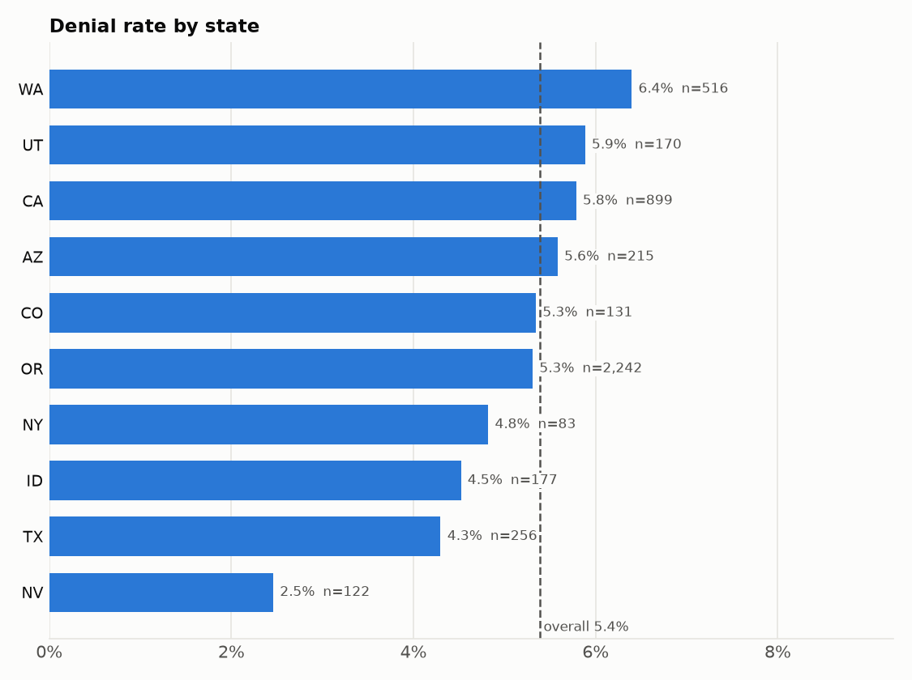

# Bias report: swipe outcomes by subgroup

*Generated by `python -m nsh_pipeline.bias.slicing` from the processed tables, as of 2025-06-15. Thresholds come from `params.yaml → bias`.*

## Summary

- **4,811 swipes analysed** out of 4,811. Dropped: 0 orphan swipes (member not in `members`) and 0 with an unknown or excluded client. 0 swipes have an unparseable paid amount and are left out of the average paid.
- Overall denial rate **5.4%**; substantiation rate **2.5%** of 4,016 paid debit-card swipes.
- **No slice is flagged.** Every slice with at least 30 swipes is within 10 points and 1.5× of the overall rate, or its gap is not significant.
- Too small to judge (fewer than 30 swipes): is_vip = True (n = 10).

## Method

- **Slices:** `state`, `group_size_bucket`, `client_status`, `age_band`, `is_vip`, `coverage_tier`, `employee_status`, `gender`. Client attributes come from `clients` (NS Demo and NSAI removed), member attributes from `members`; every swipe is joined to its client and member. Missing values form their own `Unknown` slice. `client_type` is not sliced because it is mostly null.
- **Metrics per slice**, computed with Fairlearn's `MetricFrame`: denial rate (share of swipes with status Denied), substantiation rate (share of paid debit-card swipes that need substantiation) and average paid per swipe (descriptive only, since amounts depend on the plan).
- **Flag rule** (`params.yaml → bias`): a slice is flagged when its rate is higher than the overall rate by more than 10 percentage points or 1.5×, it has at least 30 swipes, and a one-sided Fisher exact test against all other swipes gives p < 0.01 divided by the number of slices tested (Bonferroni correction: dozens of slices are tested at once, so without it chance gaps get flagged). A lower-than-overall rate is not flagged: it is no burden on the group.
- **Proxy check:** the flag with the most excess outcomes (swipes × gap to the rest) is the root candidate. Every flag on another dimension is re-tested without the root slice's swipes; a flag that disappears is reported as a proxy, not as separate bias.
- There is no model in this pipeline yet, so these outcome rates stand in for model performance per slice. The same slicing can be re-run on model predictions later.

## Results

### Flags

None.

### All slices

| Slice | Swipes | Denial rate | Paid debit swipes | Substantiation rate | Avg paid |
|---|---|---|---|---|---|
| group_size_bucket = 1-9 | 474 | 5.5% | 391 | 2.6% | $114.77 |
| group_size_bucket = 10-24 | 1,318 | 5.2% | 1,108 | 2.2% | $109.21 |
| group_size_bucket = 25-49 | 921 | 5.4% | 771 | 4.0% | $119.47 |
| group_size_bucket = 50-99 | 211 | 6.2% | 172 | 2.3% | $108.16 |
| group_size_bucket = 100-249 | 1,348 | 5.6% | 1,116 | 1.8% | $103.79 |
| group_size_bucket = 250+ | 539 | 5.0% | 458 | 2.6% | $114.70 |
| age_band = 18-25 | 708 | 6.1% | 596 | 2.3% | $115.12 |
| age_band = 26-34 | 880 | 5.3% | 736 | 2.3% | $104.04 |
| age_band = 35-44 | 913 | 5.7% | 746 | 2.5% | $105.67 |
| age_band = 45-54 | 853 | 4.9% | 711 | 2.7% | $109.58 |
| age_band = 55-64 | 1,001 | 4.6% | 842 | 2.4% | $115.07 |
| age_band = 65+ | 456 | 6.4% | 385 | 3.1% | $120.01 |
| state = AZ | 215 | 5.6% | 184 | 2.2% | $101.60 |
| state = CA | 899 | 5.8% | 750 | 1.9% | $101.13 |
| state = CO | 131 | 5.3% | 108 | 5.6% | $115.75 |
| state = ID | 177 | 4.5% | 143 | 2.1% | $120.25 |
| state = NV | 122 | 2.5% | 105 | 2.9% | $122.15 |
| state = NY | 83 | 4.8% | 66 | 4.5% | $99.25 |
| state = OR | 2,242 | 5.3% | 1,880 | 2.3% | $111.84 |
| state = TX | 256 | 4.3% | 213 | 4.2% | $136.47 |
| state = UT | 170 | 5.9% | 140 | 3.6% | $121.80 |
| state = WA | 516 | 6.4% | 427 | 2.3% | $105.02 |
| client_status = Active | 3,779 | 5.3% | 3,154 | 2.7% | $111.90 |
| client_status = Implementation | 117 | 6.8% | 98 | 1.0% | $102.07 |
| client_status = Run Out | 53 | 1.9% | 42 | 0.0% | $78.30 |
| client_status = Terminated | 862 | 5.8% | 722 | 2.1% | $108.99 |
| employee_status = COBRA Enrolled | 172 | 6.4% | 139 | 2.2% | $116.06 |
| employee_status = Enrolled | 4,493 | 5.4% | 3,756 | 2.5% | $110.86 |
| employee_status = Other | 146 | 4.8% | 121 | 2.5% | $101.76 |
| coverage_tier = EC | 741 | 5.0% | 621 | 2.6% | $111.51 |
| coverage_tier = EE | 2,353 | 5.3% | 1,950 | 2.9% | $108.31 |
| coverage_tier = EF | 944 | 5.7% | 800 | 2.2% | $118.50 |
| coverage_tier = ES | 773 | 5.6% | 645 | 1.7% | $108.11 |
| gender = F | 2,400 | 5.8% | 1,977 | 2.4% | $106.84 |
| gender = M | 2,411 | 4.9% | 2,039 | 2.6% | $114.69 |
| is_vip = False | 4,801 | 5.4% | 4,007 | 2.5% | $110.72 |
| is_vip = True | 10 | 10.0% (too small) | 9 | 0.0% (too small) | $135.09 |

## Interpretation

No subgroup is treated measurably worse on denials or substantiation. Slices below the minimum size are listed as too small to judge, not as fair.

## Mitigation

Nothing is flagged, so no reweighing is needed: every swipe keeps weight 1.0 in `data/bias/swipe_weights.parquet`.

Slices with fewer than 30 swipes are reported as too small to judge, never as fair or unfair, so a handful of swipes cannot raise or hide a flag (is_vip = True).

## Assumptions and limitations

- **Employee status buckets are our own rule** ([decision #3](https://github.com/jaira26/nsh-data-pipeline/blob/main/docs/decisions.md)): COBRA with an active benefit → COBRA Enrolled; terminated → Other; active benefit → Enrolled; otherwise Not Enrolled. A different rule would move members between `employee_status` slices.
- **Group-size buckets are our choice** ([decision #10](https://github.com/jaira26/nsh-data-pipeline/blob/main/docs/decisions.md)): 1-9, 10-24, 25-49, 50-99, 100-249, 250+. Other cut-offs would merge or split the `group_size_bucket` slices.
- **The 40-hour ticket SLA is an assumption** ([decision #4](https://github.com/jaira26/nsh-data-pipeline/blob/main/docs/decisions.md)). This report slices swipes, not tickets, so it does not use the SLA; a future fairness view of SLA breaches would inherit it.
- The flag thresholds (10 pts, 1.5×, n ≥ 30, p < 0.01 before Bonferroni) are our defaults ([decisions #16–#20](https://github.com/jaira26/nsh-data-pipeline/blob/main/docs/decisions.md)); change them in `params.yaml → bias`.
- The data is synthetic: rates reflect the generator, so this report demonstrates the method and says nothing about real NSH members.
- Dimensions are tested one at a time, plus the proxy check. Intersections such as state × age band are not tested, because most would fall below the minimum size at this data scale.
