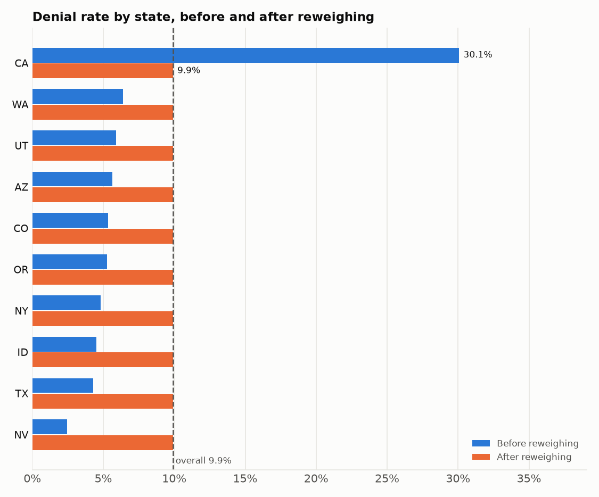

# Bias report: swipe outcomes by subgroup

*Generated by `python -m nsh_pipeline.bias.slicing` from the processed tables, as of 2025-06-15. Thresholds come from `params.yaml → bias`.*

## Summary

- **4,806 swipes analysed** out of 4,811. Dropped: 5 orphan swipes (member not in `members`) and 0 with an unknown or excluded client. 5 swipes have an unparseable paid amount and are left out of the average paid.
- Overall denial rate **9.9%**; substantiation rate **2.7%** of 3,805 paid debit-card swipes.
- **Flagged: state = CA** (denial rate 30.1% vs 9.9% overall, +20.2 pts, 3.0×, n = 898, p < 0.001).
- Too small to judge (fewer than 30 swipes): is_vip = True (n = 10).
- **Planted bias check:** injected issues are on, and `denial_skew` flipped 30% of approved swipes in state CA to Denied. Detected.

## Method

- **Slices:** `state`, `group_size_bucket`, `client_status`, `age_band`, `is_vip`, `coverage_tier`, `employee_status`, `gender`. Client attributes come from `clients` (NS Demo and NSAI removed), member attributes from `members`; every swipe is joined to its client and member. Missing values form their own `Unknown` slice. `client_type` is not sliced because it is mostly null.
- **Metrics per slice**, computed with Fairlearn's `MetricFrame`: denial rate (share of swipes with status Denied), substantiation rate (share of paid debit-card swipes that need substantiation) and average paid per swipe (descriptive only, since amounts depend on the plan).
- **Flag rule** (`params.yaml → bias`): a slice is flagged when its rate is higher than the overall rate by more than 10 percentage points or 1.5×, it has at least 30 swipes, and a one-sided Fisher exact test against all other swipes gives p < 0.01 divided by the number of slices tested (Bonferroni correction: dozens of slices are tested at once, so without it chance gaps get flagged). A lower-than-overall rate is not flagged: it is no burden on the group.
- **Proxy check:** the flag with the most excess outcomes (swipes × gap to the rest) is the root candidate. Every flag on another dimension is re-tested without the root slice's swipes; a flag that disappears is reported as a proxy, not as separate bias.
- There is no model in this pipeline yet, so these outcome rates stand in for model performance per slice. The same slicing can be re-run on model predictions later.

## Results

### Flags

| Metric | Slice | Swipes | Rate | Overall | Gap (pts) | Ratio | p-value | Verdict |
|---|---|---|---|---|---|---|---|---|
| Denial rate | state = CA | 898 | 30.1% | 9.9% | +20.2 | 3.0× | < 0.001 | flagged |

### All slices

| Slice | Swipes | Denial rate | Paid debit swipes | Substantiation rate | Avg paid |
|---|---|---|---|---|---|
| group_size_bucket = 1-9 | 473 | 7.8% | 379 | 2.6% | $150.09 |
| group_size_bucket = 10-24 | 1,317 | 7.4% | 1,078 | 2.2% | $113.07 |
| group_size_bucket = 25-49 | 921 | 11.7% | 718 | 4.3% | $120.97 |
| group_size_bucket = 50-99 | 211 | 6.2% | 172 | 2.3% | $108.16 |
| group_size_bucket = 100-249 | 1,345 | 14.3% | 1,000 | 2.0% | $103.67 |
| group_size_bucket = 250+ | 539 | 5.0% | 458 | 2.6% | $146.34 |
| age_band = 18-25 | 707 | 9.6% | 572 | 2.4% | $110.45 |
| age_band = 26-34 | 879 | 11.6% | 684 | 2.5% | $128.44 |
| age_band = 35-44 | 913 | 9.3% | 713 | 2.7% | $129.72 |
| age_band = 45-54 | 851 | 8.6% | 680 | 2.8% | $118.73 |
| age_band = 55-64 | 1,000 | 9.4% | 796 | 2.5% | $110.08 |
| age_band = 65+ | 456 | 11.8% | 360 | 3.3% | $113.95 |
| state = AZ | 213 | 5.6% | 182 | 2.2% | $102.09 |
| state = CA | 898 | 30.1% ▲ flagged | 547 | 2.6% | $72.47 |
| state = CO | 131 | 5.3% | 108 | 5.6% | $180.42 |
| state = ID | 177 | 4.5% | 142 | 2.1% | $174.48 |
| state = NV | 122 | 2.5% | 105 | 2.9% | $122.15 |
| state = NY | 83 | 4.8% | 65 | 4.6% | $99.38 |
| state = OR | 2,240 | 5.3% | 1,877 | 2.3% | $133.10 |
| state = TX | 256 | 4.3% | 212 | 4.2% | $136.94 |
| state = UT | 170 | 5.9% | 140 | 3.6% | $121.80 |
| state = WA | 516 | 6.4% | 427 | 2.3% | $105.02 |
| client_status = Active | 3,775 | 9.5% | 2,996 | 2.8% | $124.72 |
| client_status = Implementation | 116 | 6.9% | 97 | 1.0% | $102.55 |
| client_status = Run Out | 53 | 22.6% | 32 | 0.0% | $55.34 |
| client_status = Terminated | 862 | 11.1% | 680 | 2.2% | $100.73 |
| employee_status = COBRA Enrolled | 172 | 16.9% | 122 | 2.5% | $153.68 |
| employee_status = Enrolled | 4,488 | 9.5% | 3,572 | 2.7% | $118.87 |
| employee_status = Other | 146 | 13.0% | 111 | 2.7% | $86.17 |
| coverage_tier = EC | 741 | 8.2% | 600 | 2.7% | $131.32 |
| coverage_tier = EE | 2,352 | 10.8% | 1,825 | 3.1% | $114.60 |
| coverage_tier = EF | 942 | 8.7% | 771 | 2.3% | $114.43 |
| coverage_tier = ES | 771 | 10.1% | 609 | 1.8% | $126.91 |
| gender = F | 2,399 | 10.7% | 1,867 | 2.5% | $109.85 |
| gender = M | 2,407 | 9.1% | 1,938 | 2.8% | $128.36 |
| is_vip = False | 4,796 | 9.9% | 3,796 | 2.7% | $119.09 |
| is_vip = True | 10 | 10.0% (too small) | 9 | 0.0% (too small) | $135.09 |

## Interpretation

- **state = CA** has a denial rate of 30.1% against 5.3% for all other swipes (3.0× the overall rate, p < 0.001). It is the flag that stands on its own.
- **client_status = Run Out** (22.6%, n = 53) looks high but is not significant after the correction, and all of its swipes are in state = CA.
- **employee_status = COBRA Enrolled** (16.9%, n = 172) looks high but is not significant after the correction, and 41% of its swipes are in state = CA; outside it the rate is 5.9% (n = 101).

A gap like this in real data is a question for operations before it is a fairness finding: the cause could be carrier or plan rules in that slice, a claims-processing fault, or unequal treatment. Either way, anything trained on this data would learn that these members are denied more often, which is why the gap is mitigated below.

## Mitigation

### 1. Reweighing on `state`

Each swipe gets the weight P(group) × P(outcome) / P(group, outcome) (Kamiran & Calders, 2012), written to `data/bias/swipe_weights.parquet` (`swipe_id`, `weight`) for any model trained on swipes to use as `sample_weight`. Rows and outcomes are not changed.

| state | Swipes | Before | After |
|---|---|---|---|
| CA | 898 | 30.1% | 9.9% |
| WA | 516 | 6.4% | 9.9% |
| UT | 170 | 5.9% | 9.9% |
| AZ | 213 | 5.6% | 9.9% |
| CO | 131 | 5.3% | 9.9% |
| OR | 2,240 | 5.3% | 9.9% |
| NY | 83 | 4.8% | 9.9% |
| ID | 177 | 4.5% | 9.9% |
| TX | 256 | 4.3% | 9.9% |
| NV | 122 | 2.5% | 9.9% |

- Largest gap between state groups: **27.6 pts → 0.0 pts**. The overall rate stays 9.9%.
- **Trade-off, sample size:** the effective sample size drops from 4,806 to 4,469 (93%). Weights range from 0.33 to 4.03; in CA, outcome-1 swipes count 0.33× and the others 1.29×.
- **Trade-off, pooled rate:** every state group is brought to the pooled rate of 9.9%, and that pooled rate is itself raised by CA. Groups that were below it count their outcome-1 swipes more, so the weighted data no longer shows how low their rates really are.
- **Trade-off, accuracy:** reweighing hides the gap from a model; it does not remove its cause. If CA's higher rate is real (for example a stricter carrier), a model trained with these weights will under-predict it there.

### 2. Minimum-size reporting rule

Slices with fewer than 30 swipes are reported as too small to judge, never as fair or unfair, so a handful of swipes cannot raise or hide a flag (is_vip = True).

### 3. Next steps

- Find the cause of the state = CA gap with operations before any model uses this data.
- If the data feeds a model, train with the weights above or stratify the train/test split by `state`, then re-run this slicing on the model's predictions.
- The DAG re-runs this check on every pipeline run, so a new skew shows up as a warning in the `bias` task log.

## Assumptions and limitations

- **Employee status buckets are our own rule** ([decision #3](https://github.com/jaira26/nsh-data-pipeline/blob/main/docs/decisions.md)): COBRA with an active benefit → COBRA Enrolled; terminated → Other; active benefit → Enrolled; otherwise Not Enrolled. A different rule would move members between `employee_status` slices.
- **Group-size buckets are our choice** ([decision #10](https://github.com/jaira26/nsh-data-pipeline/blob/main/docs/decisions.md)): 1-9, 10-24, 25-49, 50-99, 100-249, 250+. Other cut-offs would merge or split the `group_size_bucket` slices.
- **The 40-hour ticket SLA is an assumption** ([decision #4](https://github.com/jaira26/nsh-data-pipeline/blob/main/docs/decisions.md)). This report slices swipes, not tickets, so it does not use the SLA; a future fairness view of SLA breaches would inherit it.
- The flag thresholds (10 pts, 1.5×, n ≥ 30, p < 0.01 before Bonferroni) are our defaults ([decisions #16–#20](https://github.com/jaira26/nsh-data-pipeline/blob/main/docs/decisions.md)); change them in `params.yaml → bias`.
- The data is synthetic: rates reflect the generator, so this report demonstrates the method and says nothing about real NSH members.
- Dimensions are tested one at a time, plus the proxy check. Intersections such as state × age band are not tested, because most would fall below the minimum size at this data scale.
