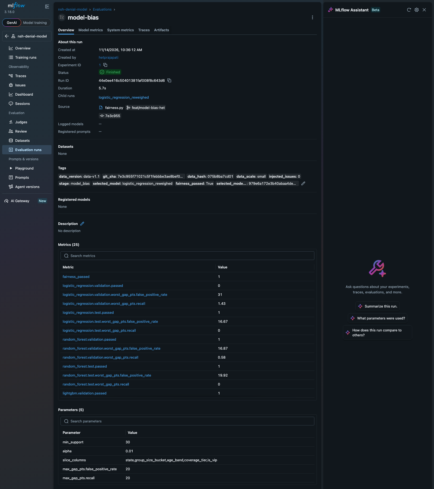
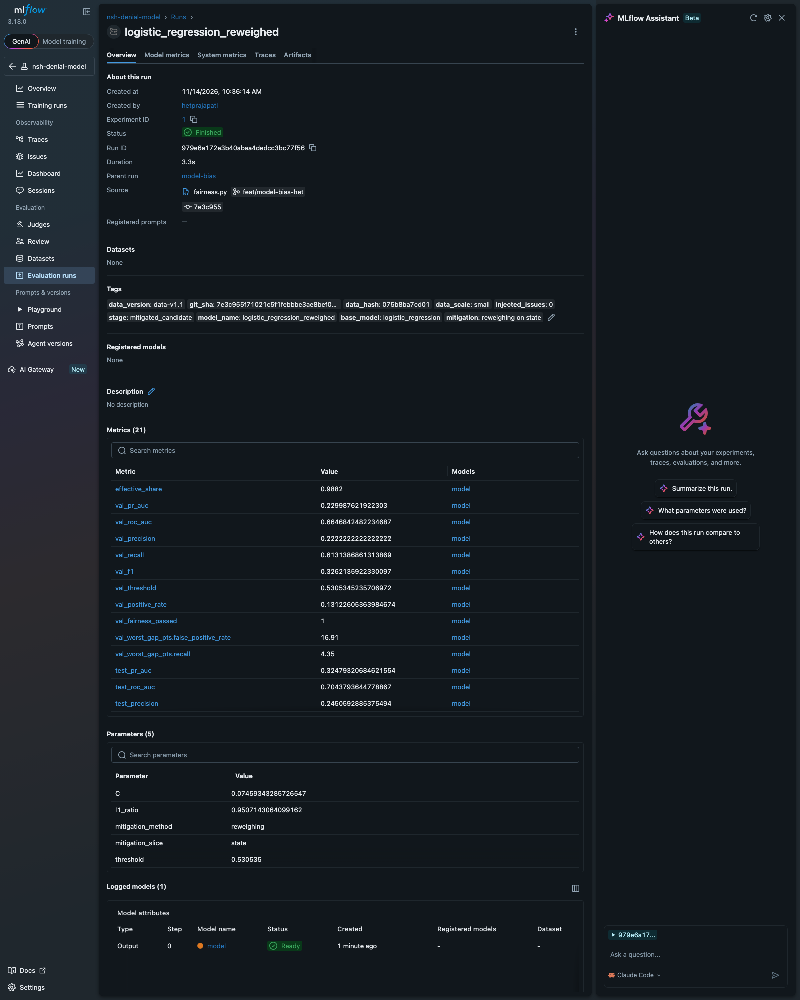
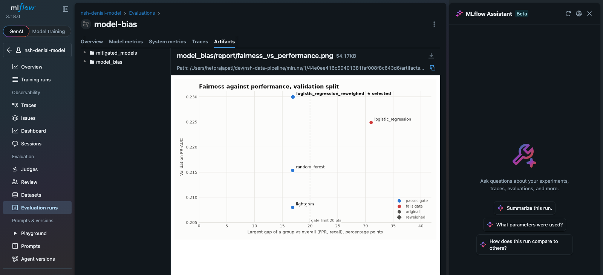
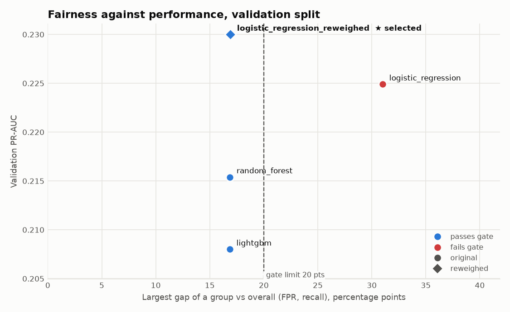
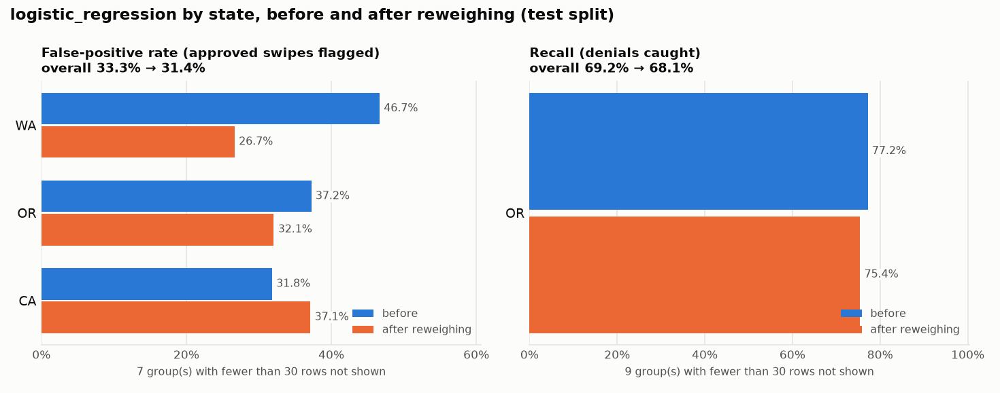
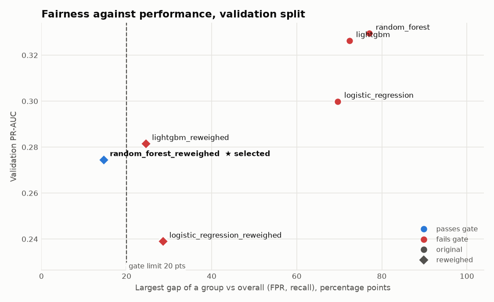
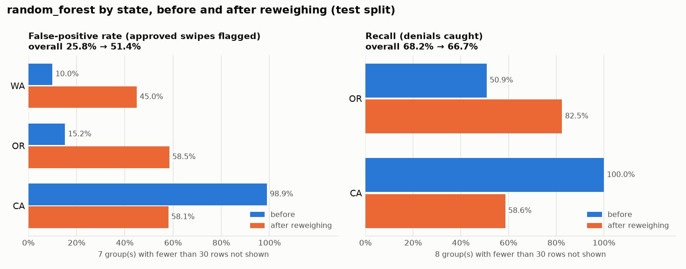

# Model bias: fairness audit, mitigation and selection after bias (phase 2)

Owner: Het Prajapati · Task assigner step 4 (guidelines §2.4–2.5, §6, §8.5–8.6) · Code: `src/nsh_pipeline/modeling/fairness*.py`

The phase-1 bias report ([docs/bias.md](bias.md)) checks the **data**: are some groups denied more often? This step
checks the **models**: given the same data, does a candidate model make more mistakes for some groups, and if so, which
candidate should ship instead? It runs after training (step 2), on every candidate, and produces the final,
fairness-aware model choice.

## How to run

```bash
dvc repro model_bias        # after build_training_set + train
# or directly:
python -m nsh_pipeline.modeling.fairness --params params.yaml --data-dir data/training \
    --models-dir models --out-dir reports/model
pytest tests/modeling/test_fairness.py tests/modeling/test_fairness_metrics.py
```

One command writes everything:

```
models/candidates/*  ──► threshold = best F1 on validation ──► per-slice audit on validation + test
                                                                  │
          candidate fails on validation? ──► reweigh train rows on the flagged slice, refit (tuned params)
                                              ──► models_mitigated/candidates/<name>_reweighed/ ──► audit again
                                                                  │
all candidates ranked by validation PR-AUC ──► selected = first that passes on validation ──► test confirms
                                                                  │
reports/model/bias.json · reports/model/bias/ (report, CSV, charts) · MLflow run "model-bias" · exit 1 if no fair model
```

Settings: `params.yaml → model_bias` (not `bias:`, which is the phase-1 data-bias section; same reasoning as
decision 37). The stage takes ~7 s at small scale.

## What is measured

Every candidate's yes/no decisions (score ≥ threshold) are sliced with Fairlearn's `MetricFrame` on the contract's
slice columns: `state`, `group_size_bucket`, `age_band`, `coverage_tier`, `is_vip`.

| Metric per group | Meaning for a member | Worse when | Gated |
|---|---|---|---|
| False-positive rate | an **approved** swipe is wrongly predicted to be denied | higher | yes, 20 pts |
| Recall | a swipe that **will be denied** is caught | lower | yes, 20 pts |
| Selection rate | share of swipes predicted denied | higher | reported only |
| Precision | share of predicted denials that really were denied | lower | reported only |
| Count, denials, base rate | context | – | – |

The two gated metrics are the two ways the decision can hurt a member (together they are Fairlearn's equalized odds).
Selection rate and precision are reported but not gated, because they also move when a group's true denial risk is
different for a legitimate reason.

**Flag rule** (same structure as the phase-1 rule, decision 17): a group is flagged on a gated metric when

1. it is **worse off than overall by more than the limit** (20 percentage points),
2. the metric's denominator has **at least 30 rows** (approved swipes for FPR, denied swipes for recall); smaller groups
   are reported as *too small to judge*, never flagged (e.g. `is_vip = True`, which has 1–2 test swipes), and
3. a **one-sided Fisher exact test** against all other rows gives **p < 0.01 ÷ number of tests** (Bonferroni).

A candidate **passes the gate** when no group is flagged.

### Why 20 points

The limit is calibrated on data-v1.1 at small scale, where state, age and VIP have **no** effect on denials by design
(decision 22):

| What the models show on clean data | Largest FPR gap vs overall |
|---|---|
| Age 18–25, **every** model family: younger members are more often new hires, and short tenure is a documented denial driver | 16.9 pts (validation) |
| Washington, logistic regression only: a state effect learned from too few clients per state | 30.3 pts |
| California with `inject_issues.denial_skew` on (planted) | 70–77 pts |

At 10 or 15 points every clean model fails on age 18–25, which is a legitimate-driver effect, not a model defect.
At 20 points the spurious and planted effects are caught and the legitimate one is reported but allowed. Revisit the
limit at full scale (more clients per state make spurious state effects smaller).

## Mitigation and selection after bias

- **Reweighing** (Kamiran & Calders, the phase-1 helper `bias/mitigation.py`): every train row gets
  P(group) · P(denied) / P(group, denied) on the **root** flagged slice (the flag with the most excess bad outcomes,
  as in the phase-1 proxy check). In the weighted train split the denial rate is equal in every group, so the model
  cannot learn the skew from it. The candidate is refit with its tuned hyperparameters and these weights; nothing is
  re-tuned, so the difference is the effect of the weights alone. The threshold is re-chosen on validation.
- The mitigated model is an ordinary Pipeline with `predict_proba(X[FEATURE_COLUMNS])` in the model contract layout,
  saved to `models_mitigated/candidates/<name>_reweighed/` (DVC does not allow this stage to write inside `models/`,
  which belongs to `train`). `models/best/` is left as training selected it.
- **Selection:** all candidates (original and mitigated) are ranked by validation PR-AUC, training's selection
  metric; ties go to the original, then the simpler family. The **selected model is the first one that passes the
  gate on the validation split**. The test split is never used to choose (as in decision 35); it only confirms the
  choice: `bias.json → passed` is the selected model's gate result on test.
- **Exit code 1** when no candidate passes, or the selected one fails on test. The report is written first, so the
  failure can be read. `--no-fail` turns this off for exploratory runs.

Not used: Fairlearn's `ThresholdOptimizer` (group-specific thresholds). It needs the group at prediction time and
gives randomized decisions, so the result is not a contract-shaped Pipeline and could not be validated, registered or
served like the other candidates.

## `reports/model/bias.json` (report contract)

Always present: `per_slice_metrics`, `max_disparity`, `mitigation_applied`, `passed`, `selected_model`
(`CONTRACT_FIELDS` in `fairness.py`).

| Field | Content |
|---|---|
| `selected_model` | e.g. `logistic_regression_reweighed`; `null` when no candidate passes |
| `selected_model_dir` | folder with `model.joblib` + `metadata.json` to register (`models/candidates/…` or `models_mitigated/candidates/…`) |
| `selected_model_mlflow_run_id` | MLflow run that holds the selected model (training's candidate run, or this stage's nested run for a mitigated model) |
| `base_model`, `mitigation_applied` | the family it came from; `null` or `{method, slice, effective_n, weight_min/max, train gap before/after, …}` |
| `passed` | selected model passes the gate on the **test** split |
| `selection_reason` | one sentence, e.g. which better-scoring candidates failed the gate |
| `threshold` | the selected model's decision threshold (best F1 on validation) |
| `gate` | limits, `min_support`, `alpha`, number of tests and corrected alpha, slice columns |
| `overall`, `performance` | the selected model's overall rates on test; PR-AUC, ROC-AUC, precision, recall, F1 on validation and test |
| `max_disparity` | per slice and metric: largest gap between two judged groups (`gap_pts`, worst/best group and value, groups too small), the metric's gate `limit_pts` (`null` = reported only) and the `flagged_groups` |
| `per_slice_metrics` | per slice and group on test: counts, rates, `flagged_metrics`, `too_small_for` |
| `flags` | test-split flags of the selected model (empty when it passes) |
| `ranking`, `candidates` | every candidate's threshold and gate result, worst gaps and flags on validation and test |
| `data_version`, `git_sha`, `mlflow_run_id`, `generated_at`, `schema_version` | lineage |

`reports/model/bias/` holds `bias_report.md`, `slice_metrics.csv` (every candidate × split × group),
`slices_<column>.png` (all four metrics per group, flagged groups in red, groups too small in gray),
`mitigation_<name>.png` and `fairness_vs_performance.png`. All of it is also logged to the MLflow run `model-bias`
(experiment `nsh-denial-model`, tags `stage=model_bias`, `data_version`, `git_sha`, `selected_model`,
`selected_model_run_id`). Each mitigated candidate gets a nested run like training's candidate runs: its params,
validation and test metrics, fairness results, tags and the fitted model (cloudpickle, as decision 33), so the final
model can be loaded with `mlflow.sklearn.load_model("runs:/<selected_model_mlflow_run_id>/model")`.

### In MLflow

| | |
|---|---|
| `model-bias` run: `data_version` / `git_sha` / `selected_model` tags, every candidate's gate metrics, gate settings |  |
| Nested run of the selected mitigated model: params, validation + test metrics, fairness results, logged model |  |
| Report files and charts logged as artifacts |  |

## Results (data-v1.1, small scale)

### Clean data: the data is fair, the selected model was not

| Candidate | Val PR-AUC | Val worst FPR gap | Val gate | Test PR-AUC | Test ROC-AUC | Test gate |
|---|---|---|---|---|---|---|
| **`logistic_regression_reweighed` ★** | **0.230** | 16.9 pts (age 18–25) | passed | 0.325 | 0.704 | passed |
| `logistic_regression` (training's pick) | 0.225 | 31.0 pts (group size 50–99) | **failed** | 0.351 | 0.714 | passed |
| `random_forest` | 0.215 | 16.9 pts | passed | 0.229 | 0.673 | passed |
| `lightgbm` | 0.208 | 16.9 pts | passed | 0.233 | 0.683 | passed |

- Training's selected logistic regression flags **63% of Washington's approved swipes** as likely denials, against
  33% overall (validation, 108 approved swipes, p < 0.001). Group size 50–99 is flagged too: those are the same
  Washington clients. Washington's real denial rate is *below* average, so this is an effect the model learned from
  having a handful of clients per state, not something in the data.
- Reweighing on `state` removes it: worst FPR gap 31.0 → 16.9 pts, effective sample size 99% of the train rows,
  validation PR-AUC 0.225 → 0.230. On test the reweighed model gives up some ranking quality (PR-AUC 0.351 → 0.325,
  ROC-AUC 0.714 → 0.704); that is the price of not using the spurious state pattern.
- The original passes on **test** (the Washington gap shrinks to 14 pts in June): choosing on validation catches what
  a single test check would have missed.





### Injected data: the planted California skew is detected and removed

`params.injected.yaml` (`inject_issues.denial_skew`: 30% of approved California swipes flipped to Denied). Full report:
[docs/model_bias/injected/bias_report.md](model_bias/injected/bias_report.md).

| Candidate | Val PR-AUC | Val worst FPR gap | Val gate | Test PR-AUC | Test ROC-AUC | Test gate |
|---|---|---|---|---|---|---|
| `random_forest` | 0.330 | 77.1 pts (CA) | **failed** | 0.357 | 0.746 | **failed** |
| `lightgbm` | 0.326 | 72.4 pts (CA) | **failed** | 0.336 | 0.726 | **failed** |
| `logistic_regression` | 0.300 | 69.7 pts (CA) | **failed** | 0.363 | 0.752 | **failed** |
| `lightgbm_reweighed` | 0.281 | 24.5 pts (age 18–25) | **failed** | 0.277 | 0.645 | passed |
| **`random_forest_reweighed` ★** | 0.275 | 14.6 pts | passed | 0.289 | 0.630 | passed |
| `logistic_regression_reweighed` | 0.239 | 28.6 pts (age 18–25) | **failed** | 0.328 | 0.648 | **failed** |

- **Detection:** every original candidate is flagged on `state = CA` (FPR 85–99% vs 15–26% overall) and on
  `state = OR` recall (Oregon's real denials are missed because the model attributes denials to California).
- **Mitigation:** reweighing on `state` closes the train denial gap (29.2 → 0.0 pts, effective sample size 94%) and
  the CA flag. The random forest is the best-ranked candidate that then passes on validation and test.





## Trade-offs

- **Accuracy.** With the planted skew, California really does have more denials in the labels, so a fair model gives up
  that signal: test PR-AUC 0.357 → 0.289 and ROC-AUC 0.746 → 0.630. On clean data the cost is small (−0.026 PR-AUC).
- **Levelling down.** On injected data the gap closes partly by raising everyone's false-positive rate (overall
  25.8% → 51.4% on test, at the re-chosen best-F1 threshold): fairer, but more approved swipes get flagged. If flags
  have a real cost, choose the threshold for a target precision instead.
- **Sample size.** Reweighing costs 1–6% of the effective sample size here. It keeps every row and needs nothing at
  prediction time.
- **It treats the symptom.** If a skew comes from an unfair denial process (as the planted one does), the process
  still needs fixing; the model just stops copying it.
- **Legitimate drivers are reported, not removed.** Age 18–25 keeps a ~17-pt FPR gap through tenure. It is visible in
  every report and below the limit; removing it would mean penalising a documented, legitimate denial driver.

## For the other owners

- **Kalpan (training):** `models/best/` is unchanged. Training's ranking is the input to the fairness-aware ranking.
- **Raj (validation):** this stage re-derives each candidate's threshold with the same best-F1-on-validation rule as
  `validation.json → threshold`. The selected model may be a mitigated one; run
  `python -m nsh_pipeline.modeling.evaluate --model-dir <bias.json → selected_model_dir>` to validate it.
- **Hiral (registry, CI):** register `bias.json → selected_model_dir`, and only when both `bias.json → passed` and the
  validation gate for that same folder pass. The stage exits 1 when no fair model exists. `models_mitigated/` is a DVC
  output, ignored by Git like `models/`.

## Known limitations

- Small scale: test groups have few denials, so most recall slices are *too small to judge* (fewer than 30 denials).
  At full scale (~605 clients) far more groups will be judged; re-check the 20-pt limit then.
- One mitigation round on one slice. A candidate whose mitigated version fails on another slice is reported, not
  re-mitigated.
- The injected dataset cannot be built with `dvc repro -P params.injected.yaml` today: `acquire` downloads the
  published (clean) release whenever `dataset.url` is set. Build it with the generator directly:

```bash
python -m nsh_pipeline.generate.run --params params.injected.yaml --out-dir data/raw_injected
python -m nsh_pipeline.preprocess.run --raw-dir data/raw_injected --out-dir data/processed_injected --as-of 2025-06-15
python -m nsh_pipeline.modeling.build --processed-dir data/processed_injected --raw-dir data/raw_injected \
    --params params.injected.yaml --out-dir data/training_injected
export MLFLOW_TRACKING_URI=sqlite:///mlflow_injected.db   # keep demo runs out of the main experiment
python -m nsh_pipeline.modeling.train --data-dir data/training_injected --params params.injected.yaml \
    --models-dir data/models_injected --reports-dir reports/injected/model/training
python -m nsh_pipeline.modeling.fairness --params params.injected.yaml --data-dir data/training_injected \
    --models-dir data/models_injected --out-dir reports/injected/model --mitigated-dir data/models_mitigated_injected
```
