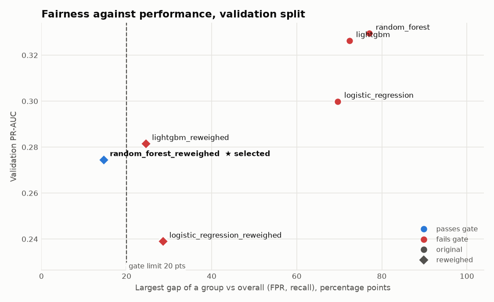
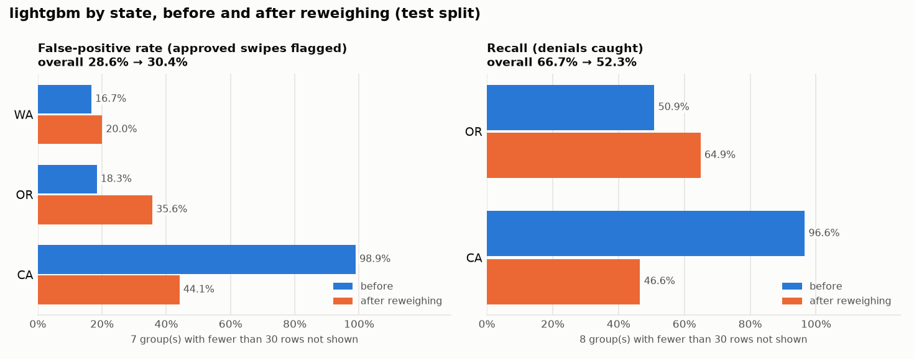
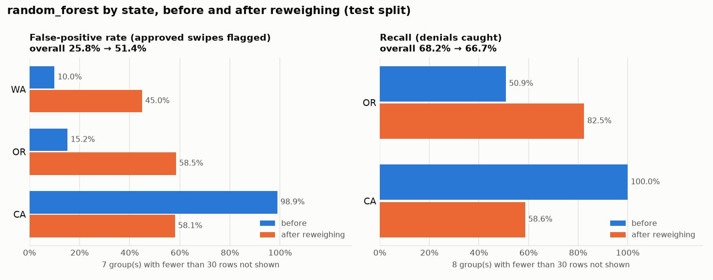
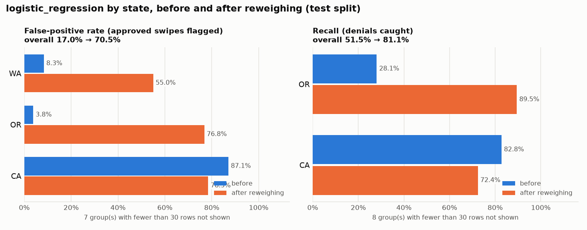
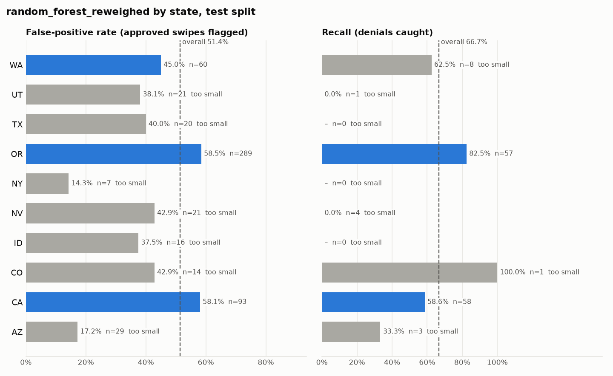
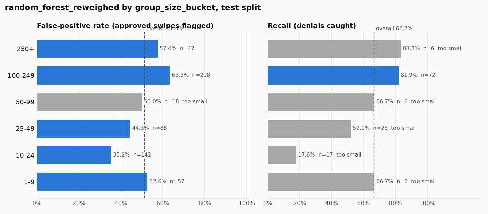
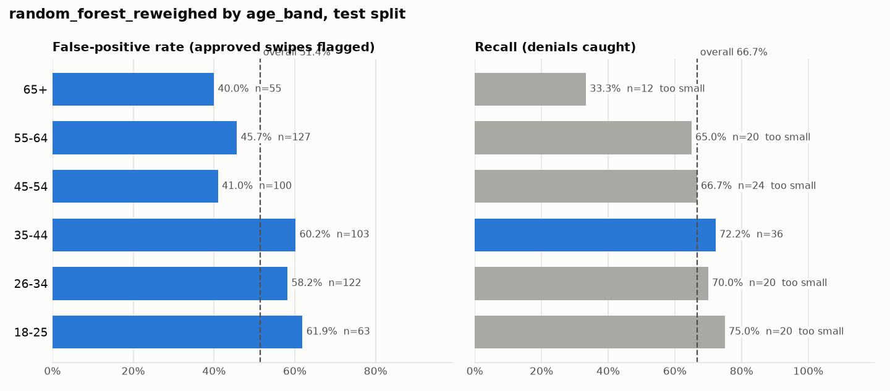
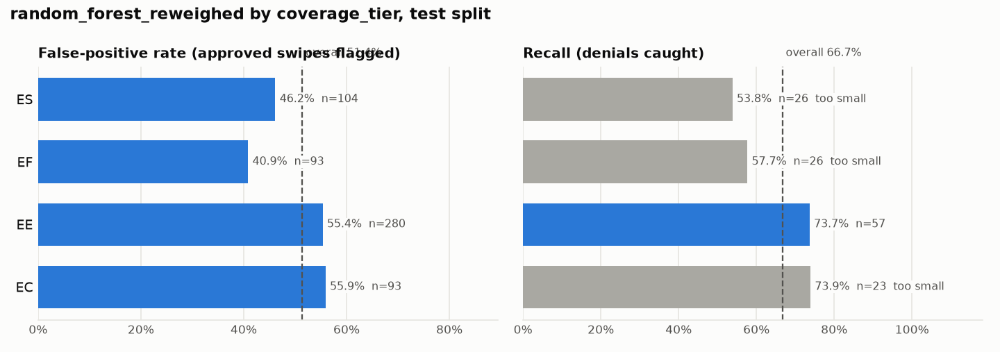
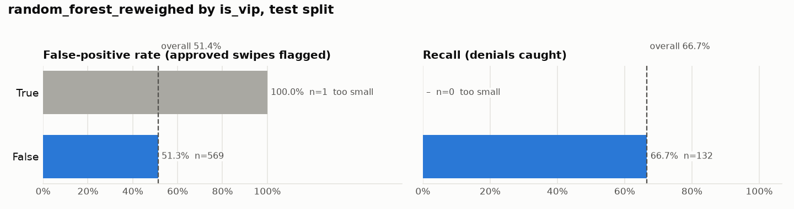

# Model bias report

Data `data-v1.1` · code `655991c47c8e` · generated 2026-11-14T15:27:42+00:00

## Verdict

- **Fairness gate passed.** Selected model: **`random_forest_reweighed`** (base `random_forest`, reweighed on `state`), decision threshold 0.475. Saved in `data/models_mitigated_injected/candidates/random_forest_reweighed`.
- random_forest_reweighed is the best-ranked candidate that passes the fairness gate on validation; better-scoring random_forest, lightgbm, logistic_regression, lightgbm_reweighed failed it.
- Test split (test, never used to choose): PR-AUC 0.289, ROC-AUC 0.630, recall 66.7%, precision 23.1%.
- No group is flagged on the test split (25 group × metric tests).
- **Planted bias check:** `inject_issues.denial_skew` is on (state CA, rate 30%). Flagged on validation for `logistic_regression`, `random_forest`, `lightgbm`.

## Candidates

Ranked by validation PR-AUC; the selected model is the first one that passes the gate on the validation split. Gaps are the largest worse-than-overall gap of any judged group.

| # | Candidate | Mitigation | Val PR-AUC | Val worst FPR gap | Val worst recall gap | Val gate | Test PR-AUC | Test gate |
|---|---|---|---|---|---|---|---|---|
| 1 | `random_forest` | – | 0.330 | 77.1 pts | 22.9 pts | **FAILED** | 0.357 | **FAILED** |
| 2 | `lightgbm` | – | 0.326 | 72.4 pts | 24.0 pts | **FAILED** | 0.336 | **FAILED** |
| 3 | `logistic_regression` | – | 0.300 | 69.7 pts | 36.2 pts | **FAILED** | 0.363 | **FAILED** |
| 4 | `lightgbm_reweighed` | reweighing on `state` | 0.281 | 24.5 pts | 11.0 pts | **FAILED** | 0.277 | passed |
| 5 | `random_forest_reweighed` ★ | reweighing on `state` | 0.275 | 14.6 pts | 11.9 pts | passed | 0.289 | passed |
| 6 | `logistic_regression_reweighed` | reweighing on `state` | 0.239 | 28.6 pts | 16.6 pts | **FAILED** | 0.328 | **FAILED** |

Flags on the validation split (these decided which candidates need mitigation):

| Candidate | Group | Metric | Group value | Overall | Gap (pts) | n | p |
|---|---|---|---|---|---|---|---|
| `random_forest` | state = CA | FPR | 99.2% | 22.1% | +77.1 | 127 | < 0.001 |
| `random_forest` | state = OR | recall | 35.4% | 58.4% | +22.9 | 79 | < 0.001 |
| `lightgbm` | state = CA | FPR | 98.4% | 26.0% | +72.4 | 127 | < 0.001 |
| `lightgbm` | state = OR | recall | 35.4% | 59.5% | +24.0 | 79 | < 0.001 |
| `logistic_regression` | state = CA | FPR | 85.0% | 15.4% | +69.7 | 127 | < 0.001 |
| `logistic_regression` | state = OR | recall | 7.6% | 43.8% | +36.2 | 79 | < 0.001 |
| `lightgbm_reweighed` | age_band = 18-25 | FPR | 52.4% | 28.0% | +24.5 | 143 | < 0.001 |
| `logistic_regression_reweighed` | age_band = 18-25 | FPR | 93.0% | 64.5% | +28.6 | 143 | < 0.001 |
| `logistic_regression_reweighed` | age_band = 26-34 | FPR | 89.5% | 64.5% | +25.1 | 143 | < 0.001 |

## Mitigation

### `lightgbm` → `lightgbm_reweighed` (reweighing on `state`)

- Training rows reweighed so the denial rate is equal in every `state` group: train gap 29.2 → 0.0 pts. Weights 0.41–4.04; effective sample size 2,770 of 2,958 rows (94%).
- Same tuned hyperparameters, refit with the weights; threshold re-chosen on validation.

| Split | Metric | Before | After |
|---|---|---|---|
| validation | PR-AUC | 0.326 | 0.281 |
| validation | recall | 0.595 | 0.530 |
| validation | precision | 0.330 | 0.290 |
| validation | overall FPR | 26.0% | 28.0% |
| validation | worst FPR gap | 72.4 pts | 24.5 pts |
| validation | worst recall gap | 24.0 pts | 11.0 pts |
| validation | fairness gate | **FAILED** | **FAILED** |
| test | PR-AUC | 0.336 | 0.277 |
| test | recall | 0.667 | 0.523 |
| test | precision | 0.351 | 0.285 |
| test | overall FPR | 28.6% | 30.4% |
| test | worst FPR gap | 70.3 pts | 18.9 pts |
| test | worst recall gap | 15.8 pts | 5.7 pts |
| test | fairness gate | **FAILED** | passed |

### `random_forest` → `random_forest_reweighed` (reweighing on `state`)

- Training rows reweighed so the denial rate is equal in every `state` group: train gap 29.2 → 0.0 pts. Weights 0.41–4.04; effective sample size 2,770 of 2,958 rows (94%).
- Same tuned hyperparameters, refit with the weights; threshold re-chosen on validation.

| Split | Metric | Before | After |
|---|---|---|---|
| validation | PR-AUC | 0.330 | 0.275 |
| validation | recall | 0.584 | 0.719 |
| validation | precision | 0.362 | 0.245 |
| validation | overall FPR | 22.1% | 47.7% |
| validation | worst FPR gap | 77.1 pts | 14.6 pts |
| validation | worst recall gap | 22.9 pts | 11.9 pts |
| validation | fairness gate | **FAILED** | passed |
| test | PR-AUC | 0.357 | 0.289 |
| test | recall | 0.682 | 0.667 |
| test | precision | 0.380 | 0.231 |
| test | overall FPR | 25.8% | 51.4% |
| test | worst FPR gap | 73.1 pts | 11.9 pts |
| test | worst recall gap | 17.3 pts | 8.1 pts |
| test | fairness gate | **FAILED** | passed |

### `logistic_regression` → `logistic_regression_reweighed` (reweighing on `state`)

- Training rows reweighed so the denial rate is equal in every `state` group: train gap 29.2 → 0.0 pts. Weights 0.41–4.04; effective sample size 2,770 of 2,958 rows (94%).
- Same tuned hyperparameters, refit with the weights; threshold re-chosen on validation.

| Split | Metric | Before | After |
|---|---|---|---|
| validation | PR-AUC | 0.300 | 0.239 |
| validation | recall | 0.438 | 0.832 |
| validation | precision | 0.380 | 0.218 |
| validation | overall FPR | 15.4% | 64.5% |
| validation | worst FPR gap | 69.7 pts | 28.6 pts |
| validation | worst recall gap | 36.2 pts | 16.6 pts |
| validation | fairness gate | **FAILED** | **FAILED** |
| test | PR-AUC | 0.363 | 0.328 |
| test | recall | 0.515 | 0.811 |
| test | precision | 0.412 | 0.210 |
| test | overall FPR | 17.0% | 70.5% |
| test | worst FPR gap | 70.1 pts | 26.3 pts |
| test | worst recall gap | 23.4 pts | 8.7 pts |
| test | fairness gate | **FAILED** | **FAILED** |

**Trade-offs.** Reweighing keeps every row and needs nothing at prediction time, but (1) it costs effective sample size, (2) a model that may no longer use the slice's denial pattern gives up any real signal in it, which shows as lower PR-AUC, and (3) it treats the symptom: if the skew comes from an unfair denial process, that process still needs fixing. Group-specific thresholds (Fairlearn `ThresholdOptimizer`) were not used: they need the group at prediction time and give randomized decisions, which breaks the model contract.

## Per-slice results: `random_forest_reweighed`, test split

Decision threshold 0.475. Overall: selection 54.3%, FPR 51.4%, recall 66.7%, precision 23.1%, 702 swipes with 132 denials.

### state

| Group | Swipes | Denials | Selection | FPR | Recall | Precision | Verdict |
|---|---|---|---|---|---|---|---|
| AZ | 32 | 3 | 18.8% | 17.2% | 33.3% | 16.7% | too small for FPR, recall |
| CA | 151 | 58 | 58.3% | 58.1% | 58.6% | 38.6% | ok |
| CO | 15 | 1 | 46.7% | 42.9% | 100.0% | 14.3% | too small for FPR, recall |
| ID | 16 | 0 | 37.5% | 37.5% | – | 0.0% | too small for FPR, recall |
| NV | 25 | 4 | 36.0% | 42.9% | 0.0% | 0.0% | too small for FPR, recall |
| NY | 7 | 0 | 14.3% | 14.3% | – | 0.0% | too small for FPR, recall |
| OR | 346 | 57 | 62.4% | 58.5% | 82.5% | 21.8% | ok |
| TX | 20 | 0 | 40.0% | 40.0% | – | 0.0% | too small for FPR, recall |
| UT | 22 | 1 | 36.4% | 38.1% | 0.0% | 0.0% | too small for FPR, recall |
| WA | 68 | 8 | 47.1% | 45.0% | 62.5% | 15.6% | too small for recall |

Largest gap between two judged groups: selection 43.7 pts (OR vs AZ); FPR 13.5 pts (OR vs WA); recall 23.8 pts (CA vs OR); precision 23.0 pts (WA vs CA).

### group_size_bucket

| Group | Swipes | Denials | Selection | FPR | Recall | Precision | Verdict |
|---|---|---|---|---|---|---|---|
| 1-9 | 63 | 6 | 54.0% | 52.6% | 66.7% | 11.8% | too small for recall |
| 10-24 | 159 | 17 | 33.3% | 35.2% | 17.6% | 5.7% | too small for recall |
| 25-49 | 113 | 25 | 46.0% | 44.3% | 52.0% | 25.0% | too small for recall |
| 50-99 | 24 | 6 | 54.2% | 50.0% | 66.7% | 30.8% | too small for FPR, recall |
| 100-249 | 290 | 72 | 67.9% | 63.3% | 81.9% | 29.9% | ok |
| 250+ | 53 | 6 | 60.4% | 57.4% | 83.3% | 15.6% | too small for recall |

Largest gap between two judged groups: selection 34.6 pts (100-249 vs 10-24); FPR 28.1 pts (100-249 vs 10-24); precision 24.3 pts (10-24 vs 100-249).

### age_band

| Group | Swipes | Denials | Selection | FPR | Recall | Precision | Verdict |
|---|---|---|---|---|---|---|---|
| 18-25 | 83 | 20 | 65.1% | 61.9% | 75.0% | 27.8% | too small for recall |
| 26-34 | 142 | 20 | 59.9% | 58.2% | 70.0% | 16.5% | too small for recall |
| 35-44 | 139 | 36 | 63.3% | 60.2% | 72.2% | 29.5% | ok |
| 45-54 | 124 | 24 | 46.0% | 41.0% | 66.7% | 28.1% | too small for recall |
| 55-64 | 147 | 20 | 48.3% | 45.7% | 65.0% | 18.3% | too small for recall |
| 65+ | 67 | 12 | 38.8% | 40.0% | 33.3% | 15.4% | too small for recall |

Largest gap between two judged groups: selection 26.2 pts (18-25 vs 65+); FPR 21.9 pts (18-25 vs 65+); precision 13.1 pts (26-34 vs 35-44).

### coverage_tier

| Group | Swipes | Denials | Selection | FPR | Recall | Precision | Verdict |
|---|---|---|---|---|---|---|---|
| EC | 116 | 23 | 59.5% | 55.9% | 73.9% | 24.6% | too small for recall |
| EE | 337 | 57 | 58.5% | 55.4% | 73.7% | 21.3% | ok |
| EF | 119 | 26 | 44.5% | 40.9% | 57.7% | 28.3% | too small for recall |
| ES | 130 | 26 | 47.7% | 46.2% | 53.8% | 22.6% | too small for recall |

Largest gap between two judged groups: selection 14.9 pts (EC vs EF); FPR 15.1 pts (EC vs EF); precision 7.0 pts (EE vs EF).

### is_vip

| Group | Swipes | Denials | Selection | FPR | Recall | Precision | Verdict |
|---|---|---|---|---|---|---|---|
| False | 701 | 132 | 54.2% | 51.3% | 66.7% | 23.2% | ok |
| True | 1 | 0 | 100.0% | 100.0% | – | 0.0% | too small for FPR, recall |

## Method

- **Decisions:** score ≥ threshold = predicted denied. Threshold = best F1 on the validation split, the same rule as training and model validation.
- **Metrics per group** (Fairlearn `MetricFrame` on each of `state`, `group_size_bucket`, `age_band`, `coverage_tier`, `is_vip`): selection rate, false-positive rate (approved swipes flagged as denials), recall (denials caught), precision, counts.
- **Gate** (`params.yaml → model_bias`): a group is flagged when it is worse off than overall by more than its metric's limit (FPR 20 pts, recall 20 pts), the metric's denominator has at least 30 rows, and a one-sided Fisher exact test against all other rows gives p < 0.01 ÷ number of tests (Bonferroni). Selection rate and precision are reported, not gated: they also move with legitimate differences in denial risk between groups.
- **Selection after bias:** candidates are ranked by validation PR-AUC; the first that passes the gate on the validation split is selected. The test split confirms the choice and is never used to make it.
- Decisions behind these rules: [docs/decisions.md](https://github.com/jaira26/nsh-data-pipeline/blob/main/docs/decisions.md) (rows on model bias).

