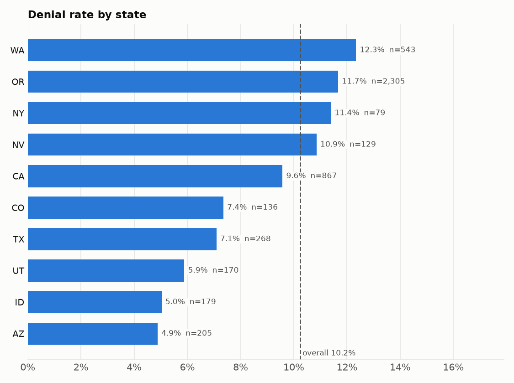

# Bias report: swipe outcomes by subgroup

*Generated by `python -m nsh_pipeline.bias.slicing` from the processed tables, as of 2025-06-15. Thresholds come from `params.yaml → bias`.*

## Summary

- **4,881 swipes analysed** out of 4,881. Dropped: 0 orphan swipes (member not in `members`) and 0 with an unknown or excluded client. 0 swipes have an unparseable paid amount and are left out of the average paid.
- Overall denial rate **10.2%**; substantiation rate **2.7%** of 3,916 paid debit-card swipes.
- **No slice is flagged.** Every slice with at least 30 swipes is within 10 points and 1.5× of the overall rate, or its gap is not significant.
- Too small to judge (fewer than 30 swipes): is_vip = True (n = 7).

## Method

- **Slices:** `state`, `group_size_bucket`, `client_status`, `age_band`, `is_vip`, `coverage_tier`, `employee_status`, `gender`. Client attributes come from `clients` (NS Demo and NSAI removed), member attributes from `members`; every swipe is joined to its client and member. Missing values form their own `Unknown` slice. `client_type` is not sliced because it is mostly null.
- **Metrics per slice**, computed with Fairlearn's `MetricFrame`: denial rate (share of swipes with status Denied), substantiation rate (share of paid debit-card swipes that need substantiation) and average paid per swipe (descriptive only, since amounts depend on the plan).
- **Flag rule** (`params.yaml → bias`): a slice is flagged when its rate is higher than the overall rate by more than 10 percentage points or 1.5×, it has at least 30 swipes, and a one-sided Fisher exact test against all other swipes gives p < 0.01 divided by the number of slices tested (Bonferroni correction: dozens of slices are tested at once, so without it chance gaps get flagged). A lower-than-overall rate is not flagged: it is no burden on the group.
- **Proxy check:** the flag with the most excess outcomes (swipes × gap to the rest) is the root candidate. Every flag on another dimension is re-tested without the root slice's swipes; a flag that disappears is reported as a proxy, not as separate bias.
- There is no model in this pipeline yet, so these outcome rates stand in for model performance per slice. The same slicing can be re-run on model predictions later.

## Results

### Flags

None.

### All slices

| Slice | Swipes | Denial rate | Paid debit swipes | Substantiation rate | Avg paid |
|---|---|---|---|---|---|
| group_size_bucket = 1-9 | 487 | 8.8% | 391 | 2.0% | $95.98 |
| group_size_bucket = 10-24 | 1,308 | 8.9% | 1,069 | 2.7% | $100.17 |
| group_size_bucket = 25-49 | 914 | 8.3% | 746 | 2.7% | $103.75 |
| group_size_bucket = 50-99 | 247 | 13.8% | 189 | 3.2% | $108.39 |
| group_size_bucket = 100-249 | 1,382 | 12.6% | 1,085 | 2.7% | $99.68 |
| group_size_bucket = 250+ | 543 | 10.5% | 436 | 2.8% | $103.07 |
| age_band = 18-25 | 727 | 12.5% | 557 | 2.9% | $105.01 |
| age_band = 26-34 | 841 | 11.5% | 677 | 2.1% | $94.77 |
| age_band = 35-44 | 935 | 11.9% | 740 | 4.1% | $100.77 |
| age_band = 45-54 | 889 | 9.6% | 713 | 3.2% | $103.30 |
| age_band = 55-64 | 1,050 | 7.1% | 869 | 1.5% | $102.19 |
| age_band = 65+ | 439 | 9.3% | 360 | 2.2% | $99.53 |
| state = AZ | 205 | 4.9% | 177 | 4.0% | $95.81 |
| state = CA | 867 | 9.6% | 707 | 3.3% | $96.31 |
| state = CO | 136 | 7.4% | 110 | 1.8% | $103.97 |
| state = ID | 179 | 5.0% | 149 | 2.0% | $84.23 |
| state = NV | 129 | 10.9% | 98 | 3.1% | $98.28 |
| state = NY | 79 | 11.4% | 65 | 1.5% | $70.78 |
| state = OR | 2,305 | 11.7% | 1,819 | 2.3% | $101.26 |
| state = TX | 268 | 7.1% | 224 | 3.1% | $117.18 |
| state = UT | 170 | 5.9% | 139 | 1.4% | $119.26 |
| state = WA | 543 | 12.3% | 428 | 3.3% | $105.67 |
| client_status = Active | 3,784 | 10.7% | 3,014 | 2.9% | $99.87 |
| client_status = Implementation | 129 | 8.5% | 110 | 1.8% | $95.30 |
| client_status = Run Out | 41 | 7.3% | 34 | 0.0% | $115.65 |
| client_status = Terminated | 927 | 8.8% | 758 | 1.8% | $105.86 |
| employee_status = COBRA Enrolled | 155 | 3.9% | 134 | 3.7% | $118.50 |
| employee_status = Enrolled | 4,606 | 10.5% | 3,678 | 2.6% | $100.78 |
| employee_status = Other | 120 | 7.5% | 104 | 2.9% | $87.61 |
| coverage_tier = EC | 712 | 11.5% | 562 | 1.4% | $101.78 |
| coverage_tier = EE | 2,368 | 10.1% | 1,912 | 3.1% | $99.35 |
| coverage_tier = EF | 947 | 11.5% | 738 | 2.8% | $97.95 |
| coverage_tier = ES | 854 | 8.3% | 704 | 2.3% | $108.44 |
| gender = F | 2,393 | 10.0% | 1,921 | 2.5% | $100.46 |
| gender = M | 2,488 | 10.5% | 1,995 | 2.8% | $101.56 |
| is_vip = False | 4,874 | 10.3% | 3,910 | 2.7% | $101.08 |
| is_vip = True | 7 | 0.0% (too small) | 6 | 0.0% (too small) | $64.20 |

## Interpretation

No subgroup is treated measurably worse on denials or substantiation. Slices below the minimum size are listed as too small to judge, not as fair.

## Mitigation

Nothing is flagged, so no reweighing is needed: every swipe keeps weight 1.0 in `data/bias/swipe_weights.parquet`.

Slices with fewer than 30 swipes are reported as too small to judge, never as fair or unfair, so a handful of swipes cannot raise or hide a flag (is_vip = True).

## Assumptions and limitations

- **Employee status buckets are our own rule** ([decision #3](https://github.com/jaira26/nsh-data-pipeline/blob/main/docs/decisions.md)): COBRA with an active benefit → COBRA Enrolled; terminated → Other; active benefit → Enrolled; otherwise Not Enrolled. A different rule would move members between `employee_status` slices.
- **Group-size buckets are our choice** ([decision #10](https://github.com/jaira26/nsh-data-pipeline/blob/main/docs/decisions.md)): 1-9, 10-24, 25-49, 50-99, 100-249, 250+. Other cut-offs would merge or split the `group_size_bucket` slices.
- **The 40-hour ticket SLA is an assumption** ([decision #4](https://github.com/jaira26/nsh-data-pipeline/blob/main/docs/decisions.md)). This report slices swipes, not tickets, so it does not use the SLA; a future fairness view of SLA breaches would inherit it.
- The flag thresholds (10 pts, 1.5×, n ≥ 30, p < 0.01 before Bonferroni) are our defaults ([decisions #16–#20](https://github.com/jaira26/nsh-data-pipeline/blob/main/docs/decisions.md)); change them in `params.yaml → bias`.
- The data is synthetic: rates reflect the generator, so this report demonstrates the method and says nothing about real NSH members.
- Dimensions are tested one at a time, plus the proxy check. Intersections such as state × age band are not tested, because most would fall below the minimum size at this data scale.
